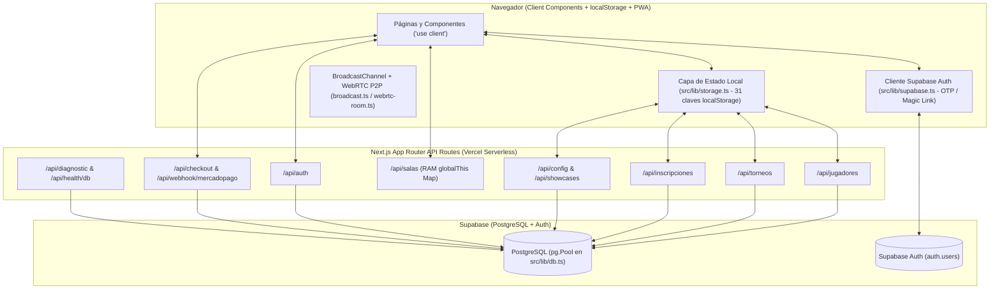

# 🛡️ AUDITORÍA TÉCNICA DE SOLO LECTURA — LOCOS POR LOS DARDOS

**Fecha de emisión:** 2026-11-05  
**Rol:** Arquitecto de Software Senior (Auditoría Técnica de Solo Lectura)  
**Estado de modificación del repositorio:** `0` archivos del proyecto modificados (únicamente se creó este informe en `Agent/AUDITORIA_2026-11-05.md`).

---

## 📋 CONTEXTO AUTODETECTADO Y CONFIRMADO

- **Ruta del proyecto:** `d:\Locos por los dardos`
- **Stack confirmado en código (`package.json`, `tsconfig.json`, `next.config.mjs`):**
  - **Framework:** Next.js `14.2.15` (App Router) + React `18.3.1` + TypeScript `5.6.2` (`strict: true`, bundler module resolution).
  - **Base de datos y acceso:** PostgreSQL en Supabase accedido mediante driver nativo `pg` (`^8.20.0`, `pg.Pool` en `src/lib/db.ts`) con SQL crudo parametrizado.
  - **Autenticación y cliente cloud:** `@supabase/supabase-js` (`^2.103.0`) para OTP/Magic Link en cliente, combinado con una capa híbrida propia en `src/app/api/auth/route.ts`, `src/lib/server-auth.ts`, `src/lib/client-auth.ts` y `localStorage`.
  - **Pagos:** `mercadopago` (`^2.12.0`) en `/api/checkout/mercadopago` y `/api/webhook/mercadopago`.
  - **Estilos y UI:** Tailwind CSS `3.4.13`, `lucide-react` (`^0.447.0`), `clsx`, `tailwind-merge`.
  - **Tiempo real y Multimedia:** WebRTC nativo (`RTCPeerConnection` en `src/lib/webrtc-room.ts`) con señalización por HTTP polling a `/api/salas`, `BroadcastChannel` (`src/lib/broadcast.ts`), y audio MP3 + Web Audio API (`src/lib/sound-effects.ts`).
  - **PWA:** Service Worker manual en `public/sw.js` (`CACHE_NAME = 'locos-dardos-v2'`) y `public/manifest.json`.
- **Rama auditada:** `main` en el commit `51c6785` (`fix(pwa): service worker network-first para HTML y boton de recarga ante ChunkLoadError`). Se verificó con `git log main..dev` y `git log dev..main` que la rama `dev` apunta exactamente al mismo commit `51c6785`. Existe además una rama local antigua `backup-anotador`.
- **Áreas críticas auditadas:**
  1. Autenticación, autorización (`SUPERADMIN` / `PRESIDENTE` / `JUGADOR`), gestión de sesiones y protección de PII (DNI, teléfono, email, dieta).
  2. Inscripciones al Gran Torneo Presencial (`/api/inscripciones`, `PresencialEnrollmentsManager.tsx`, `GrandTournamentEnrollModal.tsx`), incluyendo diagnóstico exacto de la captura adjunta por el usuario en `/superadmin`.
  3. Pagos y órdenes con Mercado Pago (`/api/checkout/mercadopago`, `/api/webhook/mercadopago`, tabla `orders`).
  4. Motor de Torneos, Llaves, Fase de Grupos y Ligas (`TournamentManager.tsx`, `bracket-engine.ts`, `/api/torneos`).
  5. Anotador 501 / Cricket, estadísticas PDC y salas online 1v1 (`DartScorer.tsx`, `X01Board.tsx`, `CricketBoard.tsx`, `online-rooms.ts`, `/api/salas`, `webrtc-room.ts`).
  6. Panel Root `/superadmin` (Vitrinas 1/2/3, `/api/showcases`, `/api/config`, `/api/sync/google-form`).
- **Prioridades de esta auditoría:**
  1. **Seguridad y privacidad de datos** (credenciales expuestas, bypass de autenticación/autorización, protección de PII, SSRF, webhooks).
  2. **Correctitud funcional e integridad de datos** (duplicación de inscriptos en `/superadmin`, pérdida de resultados en fase de grupos, órdenes de compra no persistidas, estadísticas corruptas).
  3. **Mantenibilidad y arquitectura** (desincronización entre `localStorage` y PostgreSQL, esquemas SQL divergentes, componentes monolíticos y código muerto).
  4. **Rendimiento** (consultas N+1 por cada tiro en el anotador, polling concurrente y memoria efímera en Serverless).

---

## 0. Resumen ejecutivo

### Estado general del proyecto
El proyecto tiene una **interfaz visual rica, rápida y muy bien ambientada para el circuito de dardos**, con funcionalidades avanzadas (anotador X01/Cricket con voz de Russ Bray, segunda pantalla TV estilo PDC, llaves estilo Nakka, fichas FIFA/Mortal Kombat y panel `/superadmin`). Además, el proyecto compila limpiamente en TypeScript (`npx tsc --noEmit` devuelve `0` errores).

Sin embargo, a nivel de **arquitectura backend, seguridad y sincronización de datos**, la plataforma presenta **vulnerabilidades críticas de seguridad** y **defectos de consistencia entre `localStorage`, JSONB en `tournaments` y tablas relacionales en PostgreSQL**. Varios de estos defectos ya están produciendo fallos visibles en producción, incluyendo exactamente los dos problemas observables en la captura de `/superadmin` provista por el usuario:
1. **Filas duplicadas para un mismo jugador** (`Mariano Deux (ICEMAN)` aparece en la fila #1 con DNI `23671178`, teléfono y `+1` acompañante, y nuevamente en la fila #4 con `En Acreditación`, `Sin teléfono` y `Solo`).
2. **Encabezado de la tabla de inscripciones cortado a la mitad** (`TRANSPORTE` / `VISITAN)`) debajo de la barra superior fija de `/superadmin`.

### Los 5 riesgos principales
1. **[CRÍTICO — Seguridad] Credencial de base de datos de producción en texto plano en Git y filtración pública en `/api/diagnostic` (`H-01`):** `Agent/SESSIONS.md:10-11` contiene la contraseña real de Supabase PostgreSQL commiteada en el historial de Git, y el endpoint público sin autenticación `GET /api/diagnostic` expone los primeros 15 de los 16 caracteres de `DATABASE_URL`/`DIRECT_URL` cuando se configura la contraseña cruda en Vercel.
2. **[CRÍTICO — Seguridad / PII] Bypass total de autenticación de SuperAdmin y de cuentas de jugadores (`H-02`, `H-03`, `H-04`):**
   - El PIN maestro (`NEXT_PUBLIC_ADMIN_PIN` / fallback `'ICEMAN2026!'`) es público en el bundle cliente y `storage.ts` lo envía automáticamente en los headers de cualquier visitante.
   - `LoginModal.tsx` permite entrar a cualquier cuenta (incluida `ICEMAN` con rol `SUPERADMIN`) con **1 clic sin contraseña ni OTP** buscando por apodo (`"Entrar"`) o pulsando `"¿Problemas con el correo? Ingresar directamente"`.
   - `POST /api/jugadores` y `PATCH /api/jugadores` permiten sobrescribir perfiles, categorías y estadísticas de terceros sin autenticación.
3. **[CRÍTICO — Datos / Operación en `/superadmin`] Duplicación de inscriptos y bajas/pagos "zombis" en el Gran Torneo (`H-07`):** `GET /api/inscripciones` mezcla registros reales de `grand_tournament_registrations` con registros sintéticos generados al vuelo desde `tournaments.data.enrolledPlayers` (`dniOrPassport: 'En Acreditación'`). Como la deduplicación en cliente (`storage.ts` y `superadmin/page.tsx`) se hace solo por `r.id` (`reg_...` vs `p1`), el mismo jugador aparece duplicado. Peor aún: las bajas (`DELETE`) y cambios de pago (`PATCH`) en `/api/inscripciones` solo impactan la tabla `grand_tournament_registrations`, por lo que las filas `"En Acreditación"` no se pueden borrar ni marcar como pagadas (reaparecen a los 10 segundos).
4. **[CRÍTICO — Pagos] Órdenes de Mercado Pago jamás guardadas en la base de datos y Webhook sin verificación de firma (`H-05`, `H-06`):** `/api/checkout/mercadopago` genera un `orderId` (`ORD-...`) pero **nunca hace `INSERT INTO orders`**. Cuando Mercado Pago invoca `/api/webhook/mercadopago`, el `UPDATE orders ... WHERE order_number = $2` actualiza `0` filas. Además, el webhook no valida el header `x-signature`.
5. **[ALTO — Funcionalidad Core] Vitrinas 2 y 3 de `/superadmin` desconectadas, pérdida de resultados en Fase de Grupos y Salas Online en memoria efímera (`H-09`, `H-10`, `H-12`):**
   - Guardar cambios en `/api/showcases` da siempre `401 Unauthorized` porque `saveLandingShowcasesToCloud` no envía `getAdminRequestHeaders()`, y `src/app/page.tsx` tiene las secciones de Comunidad y Clubes 100% hardcodeadas (ignora `showcases`).
   - En `TournamentManager.tsx`, al terminar un partido en vivo de Fase de Grupos (`activeLiveMatchOrigin.type === 'GROUP'`), el resultado se descarta porque `handleTournamentMatchFinished` solo procesa `type === 'BRACKET'`.
   - `/api/salas` guarda las salas online en un `Map` en RAM (`globalThis.__LPLD_ONLINE_ROOMS__`), que se pierde entre instancias Serverless en Vercel.

### Qué haría primero (Orden de prioridad inmediata)
1. **Rotar la contraseña de Supabase PostgreSQL**, eliminar `/api/diagnostic` (o protegerlo estrictamente) y limpiar `Agent/SESSIONS.md` (`H-01`).
2. **Cerrar el bypass de autenticación y proteger PII:** Eliminar el login directo sin OTP y el login en 1 clic por apodo en `LoginModal.tsx` y `/api/auth`, exigir sesión verificada o credencial de servidor real, y agregar `getAdminRequestHeaders()` donde falta (`saveLandingShowcasesToCloud`) mientras se migra a sesión firmada HTTP-only (`H-02`, `H-03`, `H-04`, `H-09`).
3. **Corregir la duplicación y las filas zombis de inscripciones en `/superadmin` (`H-07`) y el recorte visual del encabezado de tabla (`H-08`):** Unificar la fuente de verdad en `grand_tournament_registrations`, deduplicar por identidad normalizada (nombre/apodo/email/DNI) y corregir el contenedor sticky de `/superadmin`.
4. **Reparar el flujo de órdenes de Mercado Pago (`H-05`, `H-06`) y la captura de resultados de Fase de Grupos (`H-10`).**

### Qué NO tocaría
- **No cambiar el stack ni el motor de base de datos:** Next.js 14 + `pg` (`pg.Pool`) funciona bien y es rápido; **no vale la pena** migrar a Prisma ORM ni reescribir las consultas SQL que ya funcionan (basta con eliminar el archivo muerto `prisma/schema.prisma` y actualizar `src/lib/db-schema.sql`).
- **No reescribir la lógica matemática de `X01Board.tsx`, `CricketBoard.tsx` ni `bracket-engine.ts`:** La calculadora de dardos, el detector de checkouts y la generación de cuadros de 8/16/32 jugadores con avance automático de `BYE` están bien logrados; solo requieren correcciones puntuales (como el valor inicial `bestLegDarts = 99` en `H-11` y el soporte de final dinámica al archivar torneos en `H-14`).
- **No reemplazar Tailwind ni el diseño visual general de la plataforma:** La estética dark/deportiva y las cartas `UltimateDartsCard` son uno de los mayores activos del producto.

---

## 1. Alcance y metodología

### Qué se revisó (100% del código fuente de la aplicación)
Siguiendo las 6 etapas del método sin saltear ninguna:
1. **Orientación y configuración:** `package.json`, `tsconfig.json`, `next.config.mjs`, `tailwind.config.ts`, `postcss.config.js`, `.gitignore`, `public/manifest.json`, `public/sw.js`.
2. **Documentación del proyecto y del agente:** `AGENTS.md`, `Agent/INDEX.md`, `Agent/TODO.md`, `Agent/DECISIONS.md`, `Agent/SESSIONS.md`, `Agent/AUDITORIA.MD`, `Agent/ENCARGOS.md`, `ARQUITECTURA.md`, `CONFIGURACION_SUPABASE.md`.
3. **Esquemas de datos:** `src/lib/db-schema.sql` y `prisma/schema.prisma`.
4. **Capa `src/lib/` completa (15/15 archivos):** `db.ts`, `server-auth.ts`, `client-auth.ts`, `supabase.ts`, `server-players.ts`, `online-rooms.ts`, `players-data.ts`, `community-analytics.ts`, `broadcast.ts`, `constants.ts`, `storage.ts`, `types.ts`, `bracket-engine.ts`, `webrtc-room.ts`, `sound-effects.ts`.
5. **Capa `src/app/api/` completa (12/12 endpoints):** `auth/route.ts`, `checkout/mercadopago/route.ts`, `config/route.ts`, `diagnostic/route.ts`, `health/db/route.ts`, `inscripciones/route.ts`, `jugadores/route.ts`, `salas/route.ts`, `showcases/route.ts`, `sync/google-form/route.ts`, `torneos/route.ts`, `webhook/mercadopago/route.ts`.
6. **Páginas `src/app/` completas (12/12 archivos de rutas/layouts):** `layout.tsx`, `providers.tsx`, `page.tsx`, `anotador/page.tsx`, `anotador/camara-popout/page.tsx`, `asociacion/page.tsx`, `auth/callback/page.tsx`, `jugadores/page.tsx`, `ranking/page.tsx`, `reglamento/page.tsx`, `superadmin/page.tsx`, `tienda/page.tsx`, `torneos/page.tsx`, `torneos/tv-bracket/page.tsx`.
7. **Componentes `src/components/`:** Revisión completa de los módulos críticos (`PresencialEnrollmentsManager.tsx`, `GrandTournamentEnrollModal.tsx`, `TournamentHeroBanner.tsx`, `NationalRankings.tsx`, `InvitePlayersModal.tsx`, `TournamentManager.tsx`, `DartScorer.tsx`, `X01Board.tsx`, `PlayerDirectory.tsx`, `RegisterAndProfile.tsx`, `LoginModal.tsx`, `OnboardingProfileModal.tsx`, `AppShell.tsx`, `AppSidebar.tsx`) y barrido estático de imports/referencias sobre los 39 componentes del directorio.

### Qué NO se revisó (por reglas de seguridad y exclusión)
- Archivos `.env*` locales o variables cargadas en el dashboard de Vercel (prohibido por regla de confidencialidad; solo se relevaron los nombres de `process.env.*` en el código).
- Contenido interno de `node_modules/`, `.next/`, binarios de audio (`audios_russ_bray/`, `public/sounds/`) e imágenes (`Recursos/`, `public/images/`, `public/logos/`).
- Estado vivo de las tablas e índices directamente dentro del motor PostgreSQL de Supabase (no se ejecutaron consultas contra la base de producción; el esquema real en producción se dedujo de las sentencias `CREATE TABLE IF NOT EXISTS`, `ALTER TABLE`, `SELECT`, `INSERT` y `UPDATE` presentes en `src/app/api/**` y `src/lib/**`).

### Comandos de solo lectura ejecutados y resultados resumidos

| Comando ejecutado | Propósito | Resultado resumido |
| :--- | :--- | :--- |
| `git status --short` | Verificar estado inicial del árbol de trabajo | Salida vacía (árbol de trabajo 100% limpio antes de iniciar). |
| `git branch -a` | Identificar rama actual y ramas locales/remotas | Rama activa: `* main`. Otras ramas locales: `dev`, `backup-anotador`. Remotas: `origin/main`, `origin/dev`, `origin/backup-anotador`. |
| `git log -n 25 --oneline` | Analizar historial reciente de commits | Último commit `51c6785` (`fix(pwa): service worker network-first...`), precedido por `6b08174`, `d7ef6f8`, `738df86`, `db0b9f6`. |
| `git log main..dev --oneline` / `git log dev..main --oneline` | Verificar divergencia entre `main` y `dev` | Ambos vacíos (`main` y `dev` apuntan al mismo commit `51c6785`). |
| `Get-ChildItem ...` + `git log -n 50 --name-only` | Inventario de archivos y ranking de *churn* (frecuencia de cambio) | 87 archivos de código/config/docs. Mayor frecuencia de cambio: `src/app/superadmin/page.tsx` (15), `src/lib/storage.ts` (14), `src/lib/types.ts` (11), `src/components/torneos/TournamentManager.tsx` (10), `src/app/api/jugadores/route.ts` (9), `src/app/api/inscripciones/route.ts` (9). |
| `npx tsc --noEmit --incremental false` | Chequeo estático de tipos TypeScript sin emitir ni tocar `.tsbuildinfo` | Código de salida `0` (sin errores de compilación TypeScript). |
| `git ls-files audios_russ_bray Recursos public/logos` | Verificar archivos binarios duplicados versionados en Git | Confirmado: `audios_russ_bray/` (23 MP3) y `Recursos/` (14 PNG/JPG) están trackeados en Git en la raíz además de sus copias en `public/`. |
| Barrido PowerShell `Select-String` sobre `src/` | Detectar componentes sin importar y variables `process.env.*` usadas | Confirmados 5 componentes con `0` imports (`Navbar.tsx`, `Footer.tsx`, `AppTopBar.tsx`, `CheckoutGuide.tsx`, `DartKeypad.tsx`) y 10 variables de entorno referenciadas en código. |
| `git status --short` y `git diff --stat` (al cierre) | Prueba verificable de no modificación | `git diff --stat` vacío; `git status --short` muestra únicamente `?? Agent/AUDITORIA_2026-11-05.md`. |

> **Limitaciones:** No se ejecutó `npm run lint` porque `next lint` en Next.js 14 puede intentar crear o modificar `.eslintrc.json` si detecta configuración interactiva, y no existe un archivo `.eslintrc*` en el repositorio. Tampoco se ejecutaron pruebas automatizadas porque el proyecto no posee ningún test unitario ni E2E configurado.

---

## 2. Arquitectura real y discrepancias entre documentación y código

### Arquitectura real del sistema
La aplicación es un **monolito full-stack en Next.js 14 (App Router)** donde casi todas las páginas (`src/app/**/page.tsx`) y componentes son **Client Components (`'use client'`)** que operan bajo un patrón **Local-First híbrido (`localStorage` + sincronización por API Routes a PostgreSQL)**:



### Inventario de variables de entorno referenciadas en código
Solo existen **10 nombres de variables de entorno** leídos en `src/`:
1. `DATABASE_URL` (`src/lib/db.ts`, `src/app/api/diagnostic/route.ts`, `src/app/api/health/db/route.ts`)
2. `DIRECT_URL` (`src/lib/db.ts`, `src/app/api/diagnostic/route.ts`, `src/app/api/health/db/route.ts`)
3. `NEXT_PUBLIC_SUPABASE_URL` (`src/lib/supabase.ts`, `src/app/api/diagnostic/route.ts`)
4. `NEXT_PUBLIC_SUPABASE_ANON_KEY` (`src/lib/supabase.ts`, `src/app/api/diagnostic/route.ts`)
5. `ADMIN_PIN` (`src/lib/server-auth.ts`)
6. `NEXT_PUBLIC_ADMIN_PIN` (`src/lib/constants.ts`)
7. `MERCADOPAGO_ACCESS_TOKEN` (`src/app/api/checkout/mercadopago/route.ts`, `src/app/api/webhook/mercadopago/route.ts`)
8. `NEXT_PUBLIC_APP_URL` (`src/app/api/checkout/mercadopago/route.ts`)
9. `NODE_ENV` (`src/lib/db.ts`, `src/app/layout.tsx`)
10. `VERCEL` (`src/lib/db.ts`)

### Discrepancias verificadas entre la documentación y el código real

| Documento / Archivo | Lo que afirma la documentación | Lo que ocurre realmente en el código |
| :--- | :--- | :--- |
| [`AGENTS.md`](file:///d:/Locos%20por%20los%20dardos/AGENTS.md#L46-L50) | *"Desarrollo normal (`dev`): realiza git add, commit y push a la rama `dev` automáticamente. Promoción a producción (`main`): NUNCA hagas merge o push a `main` automáticamente."* | La rama activa del workspace es `main`, y los commits recientes se hicieron o fusionaron dejando `main` y `dev` en el mismo SHA (`51c6785`). |
| [`ARQUITECTURA.md`](file:///d:/Locos%20por%20los%20dardos/ARQUITECTURA.md#L1-L78) y [`prisma/schema.prisma`](file:///d:/Locos%20por%20los%20dardos/prisma/schema.prisma#L1-L263) | Afirma que el ORM del proyecto es **Prisma** (`npx prisma migrate dev`, modelos `User`, `DartSetup`, `Statistics`, `TournamentParticipant`, `Match`, `Product`, `Order`). | **Prisma no está instalado** en `package.json` ni existe ningún import de `@prisma/client` en `src/`. Todo el acceso a datos usa `pg.Pool` con SQL crudo en [`src/lib/db.ts`](file:///d:/Locos%20por%20los%20dardos/src/lib/db.ts#L1-L108) y nombres de tablas/columnas completamente distintos (`profiles`, `player_stats`, `tournaments`, `grand_tournament_registrations`, `platform_settings`). |
| [`src/lib/db-schema.sql`](file:///d:/Locos%20por%20los%20dardos/src/lib/db-schema.sql#L1-L185) | Se presenta como el *"Esquema Maestro de Base de Datos (PostgreSQL / Supabase)"*. | Está severamente desactualizado respecto de los endpoints en `src/app/api/`: **no incluye** las tablas `grand_tournament_registrations` ni `platform_settings`; en `profiles` le faltan `email`, `phone`, `birth_date`, `age`, `club`, `nationality`, `country_code`, `status`, `role`, `association_role`, `is_verified`, `dart_weight`, `dart_barrel`, `dart_shaft`, `dart_flight`; y en `tournaments` le faltan `format`, `status`, `date`, `data`, `updated_at`. En cambio, las migraciones se corren *inline* con `CREATE TABLE IF NOT EXISTS` y `ALTER TABLE` dentro de los handlers HTTP (`/api/jugadores`, `/api/inscripciones`, `/api/torneos`, `/api/config`). |
| [`Agent/DECISIONS.md`](file:///d:/Locos%20por%20los%20dardos/Agent/DECISIONS.md#L13-L23) (ADR-002) | Afirma que la validación de escritura de administrador se hace con *"PIN maestro (`ADMIN_PIN`) validado del lado del servidor mediante `src/lib/server-auth.ts`"*. | En [`src/lib/constants.ts`](file:///d:/Locos%20por%20los%20dardos/src/lib/constants.ts#L321) el PIN está expuesto al navegador vía `NEXT_PUBLIC_ADMIN_PIN || 'ICEMAN2026!'` y [`src/lib/storage.ts`](file:///d:/Locos%20por%20los%20dardos/src/lib/storage.ts#L389-L414) adjunta `getAdminRequestHeaders()` en llamadas ejecutadas por cualquier visitante común. |
| [`Agent/INDEX.md`](file:///d:/Locos%20por%20los%20dardos/Agent/INDEX.md#L33-L48) | No lista varias rutas y módulos reales creados posteriormente. | Faltan en el mapa de `INDEX.md`: `/reglamento`, `/torneos/tv-bracket`, `/anotador/camara-popout`, `/auth/callback`, `/api/config`, `/api/diagnostic`, `/api/health/db`, `/api/sync/google-form`, `src/lib/server-players.ts`, `src/lib/webrtc-room.ts`, `src/lib/sound-effects.ts` y `src/lib/community-analytics.ts`. |
| [`Agent/AUDITORIA.MD`](file:///d:/Locos%20por%20los%20dardos/Agent/AUDITORIA.MD#L30-L33) | Afirma: *"Sin vulnerabilidades detectadas en `npm audit` (0 high/critical issues)"*. | Se refiere únicamente a paquetes npm, omitiendo la contraseña de base de datos en [`Agent/SESSIONS.md`](file:///d:/Locos%20por%20los%20dardos/Agent/SESSIONS.md#L10-L11) y los endpoints sin autenticación. |

---

## 3. Hallazgos

### Tabla resumen de todos los hallazgos detectados (33 hallazgos)

| ID | Categoría | Severidad | Confianza | Ubicación principal | Título resumido | Esfuerzo |
| :--- | :--- | :--- | :--- | :--- | :--- | :--- |
| **H-01** | E. Seguridad | **Crítico** | Confirmado | `Agent/SESSIONS.md:10-11`, `src/app/api/diagnostic/route.ts:8-67` | Contraseña de BD de producción en texto plano en Git y filtración pública en `/api/diagnostic` | S |
| **H-02** | E. Seguridad | **Crítico** | Confirmado | `src/lib/server-auth.ts:10-33`, `src/lib/client-auth.ts:7-12`, `src/lib/constants.ts:321`, `src/lib/storage.ts:389-414,878-894` | Arquitectura de PIN Admin rota: secreto expuesto en bundle cliente y enviado por visitantes comunes | M |
| **H-03** | E. Seguridad | **Crítico** | Confirmado | `src/app/api/auth/route.ts:12-188`, `src/components/perfil/LoginModal.tsx:149-181,442-452,513-576` | Toma de cuenta sin contraseña ni OTP (incluyendo login en 1 clic como `SUPERADMIN` `ICEMAN`) | M |
| **H-04** | E. Seguridad | **Crítico** | Confirmado | `src/app/api/jugadores/route.ts:202-468` | Mutación no autenticada de perfiles, estadísticas, club, categoría y estado `isVerified` en `/api/jugadores` | M |
| **H-05** | D. Correctitud / Pagos | **Crítico** | Confirmado | `src/app/api/checkout/mercadopago/route.ts:10-103`, `src/app/api/webhook/mercadopago/route.ts:46-57` | Órdenes de Mercado Pago nunca se insertan en la tabla `orders`; el webhook actualiza `0` filas | M |
| **H-06** | E. Seguridad / Pagos | **Crítico** | Confirmado | `src/app/api/webhook/mercadopago/route.ts:4-92` | Webhook de Mercado Pago sin validación de firma criptográfica (`x-signature`) ni idempotencia | S |
| **H-07** | D. Correctitud / Datos | **Crítico** | Confirmado | `src/app/api/inscripciones/route.ts:116-162`, `src/app/superadmin/page.tsx:203-212`, `src/lib/storage.ts:863-876` | **[Bug #1 de Captura]** Inscriptos duplicados en `/superadmin` y filas `"En Acreditación"` imposibles de borrar o marcar pagadas | M |
| **H-08** | C. UI / Layout | **Alto** | Confirmado | `src/app/superadmin/page.tsx:1089-1155`, `src/components/superadmin/PresencialEnrollmentsManager.tsx:861,885-901` | **[Bug #2 de Captura]** Encabezado de tabla en `/superadmin` cortado bajo la barra superior sticky y solapado con `AppShell` | S |
| **H-09** | B. Contratos / UI | **Alto** | Confirmado | `src/lib/storage.ts:814-827`, `src/app/api/showcases/route.ts:40-48`, `src/app/page.tsx:36-110,238-300` | `POST /api/showcases` falla siempre con `401` y las Vitrinas 2 y 3 de `/superadmin` están 100% desconectadas de la Landing | M |
| **H-10** | D. Correctitud | **Alto** | Confirmado | `src/components/torneos/TournamentManager.tsx:1365-1382` | Pérdida total del resultado al finalizar un partido en vivo de Fase de Grupos (`type === 'GROUP'`) | S |
| **H-11** | D. Correctitud | **Alto** | Confirmado | `src/components/anotador/X01Board.tsx:239`, `src/components/anotador/DartScorer.tsx:164-209`, `src/lib/storage.ts:535-602` | Corrupción de estadísticas en el Anotador (`bestLegDarts = 99` al perder `0` legs y atribución errónea al jugador local) | S |
| **H-12** | C. Arquitectura | **Alto** | Confirmado | `src/lib/online-rooms.ts:37-43`, `src/app/api/salas/route.ts:1-225` | Salas online 1v1 y señalización WebRTC guardadas en un `Map` en memoria RAM dentro de funciones Serverless | M |
| **H-13** | E. Seguridad | **Alto** | Confirmado | `src/app/api/sync/google-form/route.ts:18-36` | Vulnerabilidad SSRF (Server-Side Request Forgery) sin autenticación en `/api/sync/google-form` | S |
| **H-14** | D. Correctitud | **Alto** | Confirmado | `src/components/torneos/TournamentManager.tsx:1012,1145-1195,1203-1227` | Archivar torneo usa ronda fija `round === 3`, inyecta estadísticas falsas (`74.5`, `14`, `156`) y no persiste ni borra en Supabase | M |
| **H-15** | D. Correctitud | **Alto** | Confirmado | `src/components/jugadores/PlayerDirectory.tsx:130-169` | Falta `playersList` en el array de dependencias de `useMemo` en `PlayerDirectory`, mostrando lista obsoleta tras cargar la nube | S |
| **H-16** | G. Rendimiento | **Alto** | Confirmado | `src/components/torneos/TournamentManager.tsx:1310-1363`, `src/app/api/torneos/route.ts:95-190`, `src/app/api/inscripciones/route.ts:17-63` | Tormenta de escrituras SQL y ejecución de DDL (`CREATE/ALTER TABLE`) en cada tiro de dardo y en cada request HTTP | M |
| **H-17** | F. Datos | **Alto** | Confirmado | `prisma/schema.prisma`, `src/lib/db-schema.sql`, `src/app/api/jugadores/route.ts:365-397` | Divergencia severa de esquema SQL, ausencia de transacciones (`BEGIN`/`COMMIT`) y falta de constraints `UNIQUE` | M |
| **H-18** | B. Inconsistencias | **Medio** | Confirmado | `src/lib/storage.ts:448-503`, `src/components/torneos/LeagueManager.tsx:1-350` | Las Ligas (`League`) solo existen en `localStorage` y jamás se sincronizan con PostgreSQL/Supabase | M |
| **H-19** | D. Correctitud | **Medio** | Confirmado | `src/components/torneos/PlayerEnrollModal.tsx:78-115`, `src/components/comunidad/GrandTournamentEnrollModal.tsx:165-230` | Desincronización bidireccional entre `PlayerEnrollModal` (`/torneos`) y `GrandTournamentEnrollModal` (`/` y `/superadmin`) | M |
| **H-20** | D. Correctitud | **Medio** | Confirmado | `src/lib/server-players.ts:126-135`, `src/app/api/jugadores/route.ts:152-160` | Colisión de IDs en jugadores creados desde inscripciones (`email.replace(/[^a-z0-9]/g, '-')`) | S |
| **H-21** | D. Correctitud | **Medio** | Confirmado | `src/components/perfil/RegisterAndProfile.tsx:148-205`, `src/lib/storage.ts:1322-1410` | Cambios en el perfil del jugador (apodo, club, dardos, avatar) en `/asociacion` no hacen `POST /api/jugadores` a la nube | S |
| **H-22** | B. Inconsistencias | **Medio** | Confirmado | `src/lib/constants.ts:62-95`, `src/components/superadmin/PresencialEnrollmentsManager.tsx:120-165` | Precios y aranceles del Gran Torneo duplicados y divergentes (`$30.000` en `constants.ts` vs `$20.000`/`$10.000` en SuperAdmin) | S |
| **H-23** | C. Arquitectura | **Medio** | Confirmado | `src/app/superadmin/page.tsx`, `src/components/torneos/TournamentManager.tsx`, `src/lib/storage.ts` | 6 archivos monolíticos superan las 1.100–3.100 líneas mezclando UI, acceso a red, estado y reglas de negocio | L |
| **H-24** | A. Código muerto | **Bajo** | Confirmado | `audios_russ_bray/`, `Recursos/`, `src/components/Navbar.tsx`, `Footer.tsx`, `AppTopBar.tsx`, `CheckoutGuide.tsx`, `DartKeypad.tsx` | Componentes huérfanos y carpetas de assets binarios duplicadas en la raíz del repositorio | S |
| **H-25** | H. Mantenibilidad | **Medio** | Confirmado | `package.json`, `tsconfig.json`, `src/` (66 ocurrencias de `any`) | Ausencia de suite de tests en motores críticos, falta de `.eslintrc.json` y uso extendido de `any` | M |
| **H-26** | E. Seguridad | **Medio** | Confirmado | `src/lib/db.ts:34,47` | `ssl: { rejectUnauthorized: false }` cableado en el pool de PostgreSQL | S |
| **H-27** | D. Correctitud | **Medio** | Confirmado | `src/components/superadmin/PresencialEnrollmentsManager.tsx:266-310` | Parseo CSV manual con `line.split(delimiter)` que se rompe cuando un campo entre comillas contiene comas | S |
| **H-28** | G. Rendimiento | **Medio** | Confirmado | `src/app/providers.tsx:146-210`, `src/app/superadmin/page.tsx:194-225` | Múltiples `setInterval` de polling sin `document.visibilityState` ni deduplicación cuando la pestaña está en segundo plano | S |
| **H-29** | D. Correctitud | **Bajo** | Confirmado | `src/lib/types.ts`, `src/components/torneos/EditTournamentModal.tsx` | Fechas de torneos guardadas como strings `YYYY-MM-DD` o texto libre interpretadas en UTC vs hora local (`ART UTC-3`) | S |
| **H-30** | G. Rendimiento | **Bajo** | Confirmado | `src/app/reglamento/page.tsx:218`, `src/components/superadmin/PresencialEnrollmentsManager.tsx` | Uso de `` crudo para imágenes pesadas e íconos externos (`flagcdn.com`) sin optimización ni dimensiones fijas | S |
| **H-31** | D. Correctitud | **Bajo** | Confirmado | `src/components/tienda/CartDrawer.tsx`, `src/app/tienda/page.tsx` | Retorno de Mercado Pago (`?payment=success`) en `/tienda` no limpia el carrito ni muestra confirmación de orden al comprador | S |
| **H-32** | E. Seguridad | **Bajo** | Confirmado | `src/app/api/**` | Ausencia total de *rate limiting* en endpoints de OTP, login, creación de salas e inscripciones públicas | M |
| **H-33** | H. Mantenibilidad | **Bajo** | Confirmado | `public/sw.js:1-93` | `CACHE_NAME = 'locos-dardos-v2'` estático en Service Worker requiere bump manual en cada release de assets estáticos | S |

---

### Detalle de los 25 hallazgos más importantes (Parte 1: `H-01` a `H-12`)

---

#### H-01 · Contraseña de base de datos de producción en texto plano en Git y filtración pública en `/api/diagnostic`
- **Categoría:** E. Seguridad (Exposición de secretos)
- **Severidad:** **Crítico**
- **Confianza:** Confirmado
- **Ubicación:**
  - [`Agent/SESSIONS.md`](file:///d:/Locos%20por%20los%20dardos/Agent/SESSIONS.md#L10-L11)
  - [`src/app/api/diagnostic/route.ts`](file:///d:/Locos%20por%20los%20dardos/src/app/api/diagnostic/route.ts#L8-L67)
  - [`src/lib/db.ts`](file:///d:/Locos%20por%20los%20dardos/src/lib/db.ts#L15-L17)
- **Evidencia:**
  1. En [`Agent/SESSIONS.md`](file:///d:/Locos%20por%20los%20dardos/Agent/SESSIONS.md#L10-L11), la bitácora versionada en Git contiene literalmente la contraseña de 16 caracteres de Supabase PostgreSQL en texto plano (`[REDACTED]`) y el proyecto (`ksfzbzkwbbJqryhJwabv`).
  2. En [`src/lib/db.ts`](file:///d:/Locos%20por%20los%20dardos/src/lib/db.ts#L15-L17), `buildSafeConnectionString` permite que `DATABASE_URL` o `DIRECT_URL` contenga únicamente la contraseña cruda (`if (!clean.startsWith('postgres://') && !clean.startsWith('postgresql://'))`).
  3. En [`src/app/api/diagnostic/route.ts`](file:///d:/Locos%20por%20los%20dardos/src/app/api/diagnostic/route.ts#L8-L67), el endpoint `GET /api/diagnostic` es público (no llama a `isAuthorizedAdmin`) y cuando `new URL(clean)` falla (porque la variable de entorno contiene la contraseña cruda de 16 caracteres), el bloque `catch` en las líneas `26-30` devuelve en JSON público:
     ```ts
     return {
       configured: true,
       validUrlFormat: false,
       length: url.length,
       preview: url.substring(0, 15) + '...'
     };
     ```
     Esto revela públicamente **15 de los 16 caracteres de la contraseña de producción** a cualquier visitante que haga `GET /api/diagnostic`.
- **Impacto:** Compromiso total de la base de datos PostgreSQL de producción (lectura, modificación o borrado de todos los perfiles, DNI, teléfonos y torneos).
- **Acción precisa:**
  1. **Dueño del proyecto (inmediato):** Rotar la contraseña de base de datos en Supabase (`Database -> Settings -> Database Password`) y actualizar `DATABASE_URL` y `DIRECT_URL` en Vercel usando la URI completa de conexión.
  2. En [`Agent/SESSIONS.md`](file:///d:/Locos%20por%20los%20dardos/Agent/SESSIONS.md#L10-L11), reemplazar la contraseña literal por `[REDACTED]`.
  3. Eliminar [`src/app/api/diagnostic/route.ts`](file:///d:/Locos%20por%20los%20dardos/src/app/api/diagnostic/route.ts) o exigir `isAuthorizedAdmin(request)` al inicio de `GET(request: Request)` y eliminar por completo el campo `preview: url.substring(0, 15)`.
  4. En [`src/lib/db.ts`](file:///d:/Locos%20por%20los%20dardos/src/lib/db.ts#L15-L17), eliminar el soporte de contraseña cruda sin esquema `postgresql://` y el `projectRef` hardcodeado.
- **Esfuerzo:** S
- **Riesgo del cambio:** Bajo (asegurarse de actualizar `DATABASE_URL` en Vercel al mismo tiempo que se rota en Supabase).
- **Dependencias con otros hallazgos:** Relacionado con `H-02` (si se protege `/api/diagnostic` con `isAuthorizedAdmin`, primero debe corregirse `H-02`).
- **Cómo verificar que quedó bien:**
  - Verificar con `Select-String -Path Agent/SESSIONS.md -Pattern "contraseña"` que no queden credenciales en texto plano.
  - Hacer `GET /api/diagnostic` sin credenciales y comprobar que devuelve `404` (si se eliminó) o `401 Unauthorized` (si se protegió) y que jamás incluye substrings de variables de entorno.

---

#### H-02 · Arquitectura de PIN Admin rota: secreto expuesto en el bundle cliente y enviado automáticamente por todos los visitantes
- **Categoría:** E. Seguridad (Autenticación y Autorización)
- **Severidad:** **Crítico**
- **Confianza:** Confirmado
- **Ubicación:**
  - [`src/lib/constants.ts`](file:///d:/Locos%20por%20los%20dardos/src/lib/constants.ts#L321)
  - [`src/lib/client-auth.ts`](file:///d:/Locos%20por%20los%20dardos/src/lib/client-auth.ts#L7-L12)
  - [`src/lib/server-auth.ts`](file:///d:/Locos%20por%20los%20dardos/src/lib/server-auth.ts#L10-L33)
  - [`src/lib/storage.ts`](file:///d:/Locos%20por%20los%20dardos/src/lib/storage.ts#L389-L414) y [`src/lib/storage.ts`](file:///d:/Locos%20por%20los%20dardos/src/lib/storage.ts#L878-L894)
- **Evidencia:**
  1. En [`src/lib/constants.ts`](file:///d:/Locos%20por%20los%20dardos/src/lib/constants.ts#L321):
     ```ts
     export const ADMIN_MASTER_PASSWORD = process.env.NEXT_PUBLIC_ADMIN_PIN || 'ICEMAN2026!';
     ```
     Al usar el prefijo `NEXT_PUBLIC_`, Next.js incrusta el valor literal en el bundle JavaScript descargado por todos los navegadores.
  2. En [`src/lib/client-auth.ts`](file:///d:/Locos%20por%20los%20dardos/src/lib/client-auth.ts#L7-L12), `getAdminRequestHeaders()` inyecta siempre `'x-admin-pin': ADMIN_MASTER_PASSWORD`.
  3. En [`src/lib/storage.ts`](file:///d:/Locos%20por%20los%20dardos/src/lib/storage.ts#L878-L894), `fetchGrandTournamentRegistrationsFromCloud()` envía `headers: getAdminRequestHeaders()` para **cualquier usuario que visite la web**. Como resultado, [`GET /api/inscripciones`](file:///d:/Locos%20por%20los%20dardos/src/app/api/inscripciones/route.ts#L67-L115) evalúa `isAdmin = isAuthorizedAdmin(request)` como `true` para **todos los visitantes** (si `ADMIN_PIN` coincide con `NEXT_PUBLIC_ADMIN_PIN` o usa el fallback) y devuelve el padrón completo con **DNI, teléfono WhatsApp, email y restricciones alimentarias sin enmascarar**.
  4. Inversamente, si en Vercel se configura `ADMIN_PIN` con un valor distinto de `NEXT_PUBLIC_ADMIN_PIN`, el cliente sigue enviando `'ICEMAN2026!'` (porque la pantalla de login de `/superadmin` en [`src/app/superadmin/page.tsx`](file:///d:/Locos%20por%20los%20dardos/src/app/superadmin/page.tsx#L168-L185) no guarda el PIN ingresado para enviarlo en los headers, sino que valida localmente `adminPinInput === ADMIN_MASTER_PASSWORD`). En ese escenario, incluso el verdadero SuperAdmin recibe `401 Unauthorized` en todas las APIs.
- **Impacto:**
  - Exposición masiva de datos personales (PII: DNI, teléfono, email) de todos los inscriptos en `GET /api/inscripciones`.
  - Cualquier visitante puede borrar torneos (`DELETE /api/torneos`), crear/modificar torneos (`POST /api/torneos`), borrar inscripciones (`DELETE /api/inscripciones`) o cambiar roles (`PATCH /api/jugadores`).
- **Acción precisa:**
  1. Eliminar el fallback `'ICEMAN2026!'` y la variable `NEXT_PUBLIC_ADMIN_PIN` del código cliente en [`src/lib/constants.ts`](file:///d:/Locos%20por%20los%20dardos/src/lib/constants.ts#L321).
  2. Crear un endpoint `POST /api/auth/admin` (o acción en `/api/auth`) que valide el PIN contra `process.env.ADMIN_PIN` **únicamente en el servidor** y emita una cookie `HttpOnly; Secure; SameSite=Lax` firmada con HMAC (`ADMIN_SESSION_TOKEN`), o bien guardar el PIN ingresado por el SuperAdmin en `sessionStorage` y enviarlo desde `getAdminRequestHeaders()` únicamente cuando el administrador se autenticó explícitamente.
  3. En [`src/lib/storage.ts`](file:///d:/Locos%20por%20los%20dardos/src/lib/storage.ts#L878-L894), `fetchGrandTournamentRegistrationsFromCloud` **no debe enviar** headers de admin en vistas públicas; solo `/superadmin` debe solicitar la vista con PII.
- **Esfuerzo:** M
- **Riesgo del cambio:** Medio (requiere coordinar el login de `/superadmin` y `LoginModal` con `server-auth.ts`).
- **Dependencias con otros hallazgos:** Base para `H-03`, `H-04`, `H-09`.
- **Cómo verificar que quedó bien:**
  - Abrir la home `/` en una ventana incógnito y verificar en DevTools (`Network -> /api/inscripciones`) que los campos `dniOrPassport`, `phoneWhatsApp` y `email` llegan vacíos (`''`).
  - Intentar `DELETE /api/torneos?id=test` sin sesión de admin y verificar que responde `401 Unauthorized`.

---

#### H-03 · Toma de cuenta sin contraseña ni OTP (incluyendo login en 1 clic como `SUPERADMIN` `ICEMAN`)
- **Categoría:** E. Seguridad (Autenticación)
- **Severidad:** **Crítico**
- **Confianza:** Confirmado
- **Ubicación:**
  - [`src/app/api/auth/route.ts`](file:///d:/Locos%20por%20los%20dardos/src/app/api/auth/route.ts#L12-L188)
  - [`src/components/perfil/LoginModal.tsx`](file:///d:/Locos%20por%20los%20dardos/src/components/perfil/LoginModal.tsx#L149-L181), [`lines 442-452`](file:///d:/Locos%20por%20los%20dardos/src/components/perfil/LoginModal.tsx#L442-L452) y [`lines 513-576`](file:///d:/Locos%20por%20los%20dardos/src/components/perfil/LoginModal.tsx#L513-L576)
- **Evidencia:**
  1. En [`src/app/api/auth/route.ts`](file:///d:/Locos%20por%20los%20dardos/src/app/api/auth/route.ts#L12-L143), `POST /api/auth` con `{ action: 'LOGIN', identifier }` busca el perfil en PostgreSQL por email o nickname y **devuelve el perfil completo (incluyendo `email`, `phone` y `role: 'SUPERADMIN'`) sin exigir contraseña, código OTP ni token de Supabase**.
  2. En [`src/components/perfil/LoginModal.tsx`](file:///d:/Locos%20por%20los%20dardos/src/components/perfil/LoginModal.tsx#L442-L452), durante el paso de ingreso de OTP (`otpSent === true`), hay un botón visible para todos los usuarios:
     ```tsx
     <button type="button" onClick={() => handleDirectLogin()} ...>
       <span>¿Problemas con el correo? Ingresar directamente</span>
     </button>
     ```
     Al pulsarlo, `handleDirectLogin()` llama a `/api/auth` con `action: 'LOGIN'` e inicia sesión inmediatamente sin verificar el código OTP enviado al correo.
  3. Más grave aún: en [`src/components/perfil/LoginModal.tsx`](file:///d:/Locos%20por%20los%20dardos/src/components/perfil/LoginModal.tsx#L513-L576) (pestaña `"Buscar por apodo"`), cada jugador listado tiene un botón `"Entrar"` (líneas `552-558`) que ejecuta:
     ```tsx
     onClick={() => {
       saveCurrentUserId(p.id);
       onSuccess(p.id);
     }}
     ```
     Si un visitante escribe `ICEMAN` en el buscador de apodos y hace clic en `"Entrar"`, entra directamente como `Mariano Deux (ICEMAN)` (`SUPERADMIN`) **saltándose incluso el modal `showAdminPasswordPrompt`**.
- **Impacto:** Cualquier persona en internet puede suplantar la identidad de cualquier jugador federado o del propio SuperAdmin (`ICEMAN`) en 1 clic, además de extraer el `email` y `phone` reales de cualquier jugador vía `POST /api/auth`.
- **Acción precisa:**
  1. En [`src/components/perfil/LoginModal.tsx`](file:///d:/Locos%20por%20los%20dardos/src/components/perfil/LoginModal.tsx#L442-L452), eliminar el botón `"¿Problemas con el correo? Ingresar directamente"` y la función `handleDirectLogin` sin token.
  2. En [`src/components/perfil/LoginModal.tsx`](file:///d:/Locos%20por%20los%20dardos/src/components/perfil/LoginModal.tsx#L513-L576), cuando el usuario selecciona un perfil en `"Buscar por apodo"`, no llamar a `saveCurrentUserId(p.id)` directamente: si el perfil tiene `email`, disparar el flujo de OTP a su email (o exigir el PIN de Admin si `isSuperAdminProfile(p)`).
  3. En [`src/app/api/auth/route.ts`](file:///d:/Locos%20por%20los%20dardos/src/app/api/auth/route.ts#L12-L143), exigir el `access_token` de sesión de Supabase (`supabase.auth.getUser(token)`) antes de devolver datos privados (`email`, `phone`) o autenticar una cuenta existente.
- **Esfuerzo:** M
- **Riesgo del cambio:** Medio (los jugadores sin email cargado que fueron importados por planilla deberán reclamar su cuenta asociando un email o mediante validación de un administrador).
- **Dependencias con otros hallazgos:** Relacionado con `H-02` y `H-04`.
- **Cómo verificar que quedó bien:**
  - Abrir el modal `"Ingresar"`, buscar `"ICEMAN"` por apodo y verificar que no permite iniciar sesión sin credencial verificada.
  - Hacer `POST /api/auth` con `{"action":"LOGIN","identifier":"ICEMAN"}` sin token y verificar que devuelve `401`.

---

#### H-04 · Mutación no autenticada de perfiles, estadísticas, club, categoría y estado `isVerified` en `/api/jugadores`
- **Categoría:** E. Seguridad (Autorización y Control de Acceso)
- **Severidad:** **Crítico**
- **Confianza:** Confirmado
- **Ubicación:** [`src/app/api/jugadores/route.ts`](file:///d:/Locos%20por%20los%20dardos/src/app/api/jugadores/route.ts#L202-L468)
- **Evidencia:**
  1. `POST /api/jugadores` ([`lines 202-409`](file:///d:/Locos%20por%20los%20dardos/src/app/api/jugadores/route.ts#L202-L409)) no realiza **ninguna verificación de autenticación**. Si el body incluye el `email` o `nickname` de un jugador existente ([`lines 254-275`](file:///d:/Locos%20por%20los%20dardos/src/app/api/jugadores/route.ts#L254-L275)), el endpoint sobrescribe su `name`, `nickname`, `club`, `province`, `city`, `category`, `avatar_url`, `setup` de dardos y sus estadísticas en `player_stats` (`avg`, `matches_played`, `matches_won`, `one_eighties`, `highest_checkout`, `best_leg_darts`, `NineDarters`).
  2. `PATCH /api/jugadores` ([`lines 415-468`](file:///d:/Locos%20por%20los%20dardos/src/app/api/jugadores/route.ts#L415-L468)) tiene la siguiente condición en la línea `422`:
     ```ts
     if ((role || status) && !isAuthorizedAdmin(request)) {
       return NextResponse.json({ error: 'No autorizado...' }, { status: 401 });
     }
     ```
     Si el atacante omite `role` y `status` en el JSON, puede hacer `PATCH /api/jugadores` sobre cualquier `id` para modificar `category`, `associationRole` (ej. ponerse `'Presidente'`), `isVerified: true`, `nickname`, `club`, `birthDate` y `age` sin ninguna autenticación.
- **Impacto:** Manipulación arbitraria del Ranking Nacional, robo de apodos, auto-verificación de cuentas y vandalismo sobre fichas federadas.
- **Acción precisa:**
  1. En `PATCH /api/jugadores` ([`src/app/api/jugadores/route.ts`](file:///d:/Locos%20por%20los%20dardos/src/app/api/jugadores/route.ts#L421-L429)), exigir `isAuthorizedAdmin(request)` para `role`, `status`, `category`, `associationRole` e `isVerified`, y exigir autenticación del propio jugador (o admin) para el resto de los campos.
  2. En `POST /api/jugadores` ([`src/app/api/jugadores/route.ts`](file:///d:/Locos%20por%20los%20dardos/src/app/api/jugadores/route.ts#L250-L360)), cuando se detecta colisión con un perfil existente (`existingRes.rows.length > 0`), permitir el `UPDATE` únicamente si la petición está autenticada como ese usuario o como administrador autorizado.
- **Esfuerzo:** M
- **Riesgo del cambio:** Medio (verificar que el flujo de actualización de estadísticas al terminar un partido envíe las credenciales de sesión correspondientes).
- **Dependencias con otros hallazgos:** Depende de `H-02` y `H-03`.
- **Cómo verificar que quedó bien:**
  - Enviar `PATCH /api/jugadores` con `{"id":"user-iceman-admin","isVerified":false,"associationRole":"Hack"}` sin headers de autorización y comprobar que devuelve `401 Unauthorized`.

---

#### H-05 · Órdenes de Mercado Pago nunca se insertan en la tabla `orders`; el webhook actualiza `0` filas
- **Categoría:** D. Correctitud y Robustez (Pagos / Dinero)
- **Severidad:** **Crítico**
- **Confianza:** Confirmado
- **Ubicación:**
  - [`src/app/api/checkout/mercadopago/route.ts`](file:///d:/Locos%20por%20los%20dardos/src/app/api/checkout/mercadopago/route.ts#L10-L103)
  - [`src/app/api/webhook/mercadopago/route.ts`](file:///d:/Locos%20por%20los%20dardos/src/app/api/webhook/mercadopago/route.ts#L46-L57)
- **Evidencia:**
  1. En [`src/app/api/checkout/mercadopago/route.ts`](file:///d:/Locos%20por%20los%20dardos/src/app/api/checkout/mercadopago/route.ts#L42-L90), el endpoint genera:
     ```ts
     const orderId = `ORD-${Date.now()}-${Math.floor(Math.random() * 1000)}`;
     ```
     y lo envía a Mercado Pago como `external_reference: orderId`, pero **no importa `query` de `@/lib/db` ni ejecuta ningún `INSERT INTO orders`**.
  2. Cuando el cliente paga y Mercado Pago llama a [`src/app/api/webhook/mercadopago/route.ts`](file:///d:/Locos%20por%20los%20dardos/src/app/api/webhook/mercadopago/route.ts#L48-L55), el webhook ejecuta:
     ```ts
     await query(
       `UPDATE orders 
        SET payment_status = $1, mp_payment_id = $2 
        WHERE order_number = $3`,
       [orderStatus, String(paymentId), externalReference]
     );
     ```
     Como ninguna parte del código inserta jamás en la tabla `orders`, el `UPDATE` afecta `0` filas y el pago queda huérfano en la base de datos.
- **Impacto:** Pérdida de trazabilidad de ventas pagadas con dinero real en la Tienda Oficial; ninguna compra queda registrada en PostgreSQL.
- **Acción precisa:**
  1. En [`src/app/api/checkout/mercadopago/route.ts`](file:///d:/Locos%20por%20los%20dardos/src/app/api/checkout/mercadopago/route.ts#L42-L88), antes de retornar `init_point`, insertar la orden en estado `'PENDING'` en la tabla `orders` (creando la tabla si no existe o asegurando el esquema con `order_number`, `buyer_name`, `buyer_email`, `buyer_phone`, `shipping_address`, `shipping_city`, `shipping_province`, `shipping_postal_code`, `total_ars`, `mp_preference_id`, `payment_status`, `items_json`).
  2. En [`src/app/api/webhook/mercadopago/route.ts`](file:///d:/Locos%20por%20los%20dardos/src/app/api/webhook/mercadopago/route.ts#L48-L55), verificar `rowCount` del `UPDATE` y, si es `0`, hacer un `INSERT` de contingencia con los metadatos devueltos por `payment.get({ id: paymentId })` para no perder jamás un cobro aprobado.
- **Esfuerzo:** M
- **Riesgo del cambio:** Bajo (agrega persistencia donde hoy no hay ninguna).
- **Dependencias con otros hallazgos:** Complementario con `H-06` y `H-31`.
- **Cómo verificar que quedó bien:**
  - Iniciar un checkout en `/tienda`, verificar que se crea una fila con `payment_status = 'PENDING'` en `orders`, y tras simular el webhook comprobar que pasa a `'APPROVED'`.

---

#### H-06 · Webhook de Mercado Pago sin validación de firma criptográfica (`x-signature`) ni idempotencia
- **Categoría:** E. Seguridad / D. Correctitud (Pagos)
- **Severidad:** **Crítico**
- **Confianza:** Confirmado
- **Ubicación:** [`src/app/api/webhook/mercadopago/route.ts`](file:///d:/Locos%20por%20los%20dardos/src/app/api/webhook/mercadopago/route.ts#L4-L92)
- **Evidencia:**
  - El handler `POST(request: Request)` lee `url.searchParams` y `request.json()` sin verificar los headers `x-signature` ni `x-request-id` enviados por Mercado Pago (`MERCADOPAGO_WEBHOOK_SECRET`).
  - Además, en las líneas `36-45`, si `accessToken === 'TEST-00000000-0000-0000-0000-000000000000'` (el valor por defecto cuando no está configurada la variable), loguea `[Simulación Webhook MP] Pago aprobado simulado` y responde `200 OK`.
- **Impacto:** Falsificación de notificaciones de pago o ejecución no autorizada del webhook si el entorno queda sin token configurado.
- **Acción precisa:**
  1. Eliminar el fallback `'TEST-00000000-0000-0000-0000-000000000000'` en producción (`if (!accessToken) return NextResponse.json({ error: 'MP no configurado' }, { status: 503 })`).
  2. Validar el HMAC-SHA256 del header `x-signature` (`ts` y `v1`) usando `MERCADOPAGO_WEBHOOK_SECRET` según la documentación oficial de Mercado Pago antes de procesar el evento.
- **Esfuerzo:** S
- **Riesgo del cambio:** Bajo (requiere configurar `MERCADOPAGO_WEBHOOK_SECRET` en Vercel).
- **Dependencias con otros hallazgos:** Relacionado con `H-05`.
- **Cómo verificar que quedó bien:**
  - Enviar un `POST /api/webhook/mercadopago` sin header `x-signature` válido y comprobar que responde `401 Unauthorized`.

---

#### H-07 · [Bug #1 de Captura] Inscriptos duplicados en `/superadmin` y filas `"En Acreditación"` imposibles de borrar o marcar como pagadas
- **Categoría:** D. Correctitud y Robustez / B. Inconsistencias de Datos
- **Severidad:** **Crítico**
- **Confianza:** Confirmado (Explica con exactitud matemática el Bug #1 visible en la captura adjunta por el usuario)
- **Ubicación:**
  - [`src/app/api/inscripciones/route.ts`](file:///d:/Locos%20por%20los%20dardos/src/app/api/inscripciones/route.ts#L116-L162) y [`lines 254-336`](file:///d:/Locos%20por%20los%20dardos/src/app/api/inscripciones/route.ts#L254-L336)
  - [`src/lib/storage.ts`](file:///d:/Locos%20por%20los%20dardos/src/lib/storage.ts#L863-L914)
  - [`src/app/superadmin/page.tsx`](file:///d:/Locos%20por%20los%20dardos/src/app/superadmin/page.tsx#L203-L212)
  - [`src/components/superadmin/PresencialEnrollmentsManager.tsx`](file:///d:/Locos%20por%20los%20dardos/src/components/superadmin/PresencialEnrollmentsManager.tsx#L332-L389)
- **Evidencia:**
  1. En la captura de pantalla del usuario (`locosporlosdardos.com.ar/superadmin`), **Mariano Deux (ICEMAN)** aparece dos veces:
     - **Fila 1:** DNI `23671178`, `+5492235320777`, `marianodeux@gmail.com`, `Jornada Doble`, `+1` acompañante, `2 cubiertos`, `501 Individual + Parejas (Sorteo a Ciegas)`.
     - **Fila 4:** `En Acreditación`, `Sin teléfono`, `Jornada Doble`, `Solo`, `1 cubierto`, `501 Individual`.
  2. **Por qué ocurre esto en el código:**
     - En [`src/app/api/inscripciones/route.ts`](file:///d:/Locos%20por%20los%20dardos/src/app/api/inscripciones/route.ts#L116-L162), `GET /api/inscripciones` primero consulta `grand_tournament_registrations` (de donde sale la **Fila 1** con `id: 'reg_...'`), y luego hace `SELECT id, title, data FROM tournaments` (ignorando además el parámetro `tournamentId` de la query) para recorrer `tData.enrolledPlayers` y fabricar registros sintéticos con:
       ```ts
       id: p.id || `enrolled-${row.id}-${normName}`,
       dniOrPassport: isAdmin ? (p.dni || 'En Acreditación') : '',
       phoneWhatsApp: isAdmin ? (p.phone || '') : '',
       companionsCount: 0,
       dinnerComensalesCount: 1,
       categories: ['INDIVIDUAL_501'],
       ```
       De ahí nacen las filas con `"En Acreditación"`, `"Sin teléfono"`, `"Solo"`, `"1 cubierto"` y `"501 Individual"`.
     - Aunque el servidor intenta filtrar por `registeredNames.has(normName)` en la línea `131`, en el cliente tanto [`addGrandTournamentRegistration`](file:///d:/Locos%20por%20los%20dardos/src/lib/storage.ts#L863-L876) como el polling de [`src/app/superadmin/page.tsx`](file:///d:/Locos%20por%20los%20dardos/src/app/superadmin/page.tsx#L203-L212) fusionan la lista local (`getGrandTournamentRegistrations()`) con la nube usando un `Map` indexado **únicamente por `r.id`**:
       ```ts
       const rMap = new Map<string, GrandTournamentRegistration>();
       getGrandTournamentRegistrations().forEach(r => rMap.set(r.id, r));
       cloudRegs.forEach(r => rMap.set(r.id, r));
       ```
       Como el registro sintético que ya estaba cacheado en `localStorage` tiene `id: 'p1'` (o `'user-iceman-admin'`) y la inscripción completa del formulario tiene `id: 'reg_17...'`, **ambos tienen distinto `id`**, por lo que `rMap` conserva los dos y renderiza la Fila 1 y la Fila 4 simultáneamente.
  3. **Por qué las filas `"En Acreditación"` no se pueden borrar ni actualizar:**
     - `PATCH /api/inscripciones` ([`lines 254-309`](file:///d:/Locos%20por%20los%20dardos/src/app/api/inscripciones/route.ts#L254-L309)) y `DELETE /api/inscripciones` ([`lines 315-336`](file:///d:/Locos%20por%20los%20dardos/src/app/api/inscripciones/route.ts#L315-L336)) ejecutan únicamente `UPDATE` / `DELETE FROM grand_tournament_registrations WHERE id = $1`.
     - Jamás actualizan ni eliminan al jugador de `tournaments.data.enrolledPlayers`. Por lo tanto, cuando el administrador borra o cambia el estado de pago de una fila `"En Acreditación"` (como las filas 2, 3 o 4 de la captura), la base de datos modifica `0` filas y a los 10 segundos el polling de `/superadmin` la vuelve a traer intacta.
- **Impacto:** Conteo falso de jugadores acreditados, comensales de la cena y recaudación en `/superadmin`, e imposibilidad de gestionar (aprobar pago, editar o dar de baja) a los jugadores provenientes de `tournaments.data.enrolledPlayers`.
- **Acción precisa:**
  1. En [`src/app/api/inscripciones/route.ts`](file:///d:/Locos%20por%20los%20dardos/src/app/api/inscripciones/route.ts#L116-L162):
     - Respetar el filtro `tournamentId` también al consultar `tournaments`.
     - Al cruzar `enrolledPlayers` contra `grand_tournament_registrations`, comparar no solo igualdad exacta de `fullName`, sino también si el nombre incluye el `nickname`, o si coincide el `nickname`, `email` o `id` (ej. `"Mariano Deux (ICEMAN)"` vs `fullName: "Mariano Deux"` + `nickname: "ICEMAN"`).
     - En lugar de devolver objetos sintéticos volátiles en cada `GET`, hacer un *backfill* único insertando los `enrolledPlayers` faltantes como filas reales en `grand_tournament_registrations` (con un ID estable), o bien en `DELETE /api/inscripciones` y `PATCH /api/inscripciones` sincronizar también `tournaments.data.enrolledPlayers`.
  2. En [`src/lib/storage.ts`](file:///d:/Locos%20por%20los%20dardos/src/lib/storage.ts#L863-L914) y [`src/app/superadmin/page.tsx`](file:///d:/Locos%20por%20los%20dardos/src/app/superadmin/page.tsx#L203-L212):
     - En `fetchGrandTournamentRegistrationsFromCloud`, **reemplazar** la caché local del torneo por la respuesta canónica del servidor (en vez de hacer `rMap.set(r.id, r)` manteniendo registros sintéticos viejos de `localStorage`), y deduplicar por identidad normalizada `(tournamentId + nickname/email/fullName)` priorizando siempre el registro que tenga DNI real (`dniOrPassport !== 'En Acreditación'`).
- **Esfuerzo:** M
- **Riesgo del cambio:** Bajo (elimina duplicados y habilita la edición/borrado real de todas las filas).
- **Dependencias con otros hallazgos:** Relacionado con `H-19`.
- **Cómo verificar que quedó bien:**
  - Abrir `/superadmin -> Gran Torneo`, verificar que `Mariano Deux (ICEMAN)` aparece una única vez (con sus datos completos de DNI `23671178`, teléfono y `2 cubiertos`), y probar cambiar el estado de pago o eliminar cualquier fila `"En Acreditación"` verificando que persiste tras esperar 15 segundos o recargar con `F5`.

---

#### H-08 · [Bug #2 de Captura] Encabezado de tabla en `/superadmin` cortado bajo la barra superior sticky y doble barra de navegación con `AppShell`
- **Categoría:** C. Arquitectura UI / Layout
- **Severidad:** **Alto**
- **Confianza:** Confirmado (Explica el Bug #2 visible en la captura adjunta por el usuario)
- **Ubicación:**
  - [`src/components/layout/AppShell.tsx`](file:///d:/Locos%20por%20los%20dardos/src/components/layout/AppShell.tsx#L13-L37)
  - [`src/app/superadmin/page.tsx`](file:///d:/Locos%20por%20los%20dardos/src/app/superadmin/page.tsx#L1089-L1155)
  - [`src/components/superadmin/PresencialEnrollmentsManager.tsx`](file:///d:/Locos%20por%20los%20dardos/src/components/superadmin/PresencialEnrollmentsManager.tsx#L861-L905)
- **Evidencia:**
  1. En la captura del usuario se observa en el borde superior de la tabla cómo el texto del encabezado (`TRANSPORTE` / `VISITAN)`) queda **rebanado horizontalmente a la mitad** por debajo del header de `SUPER ADMIN ROOT`.
  2. En [`src/app/superadmin/page.tsx`](file:///d:/Locos%20por%20los%20dardos/src/app/superadmin/page.tsx#L1099), el header de SuperAdmin tiene `className="sticky top-0 z-30 bg-[#0b0f19]/95 backdrop-blur-md border-b border-red-500/20 px-4 sm:px-8 py-4"`, mientras que la tabla en [`PresencialEnrollmentsManager.tsx`](file:///d:/Locos%20por%20los%20dardos/src/components/superadmin/PresencialEnrollmentsManager.tsx#L861-L901) está dentro de un `<div className="overflow-x-auto">` sin altura máxima (`max-h`) ni `sticky` offset en el `<thead>`. Al hacer scroll vertical en la página para ver las filas de la tabla, el `<thead>` se desliza parcialmente debajo del header `sticky top-0 z-30` con `backdrop-blur-md`, quedando cortado a la mitad.
  3. Además, en [`src/components/layout/AppShell.tsx`](file:///d:/Locos%20por%20los%20dardos/src/components/layout/AppShell.tsx#L15), `isStandaloneTv` solo excluye `/torneos/tv-bracket` y `/anotador/camara-popout`, por lo que `/superadmin` renderiza simultáneamente la barra lateral `AppSidebar` de la app (`LPD MDQ`) y su propia navegación interna.
- **Impacto:** Degradación visual directa en `/superadmin` y pérdida de referencia de las columnas al desplazarse por la lista de inscriptos.
- **Acción precisa:**
  1. En [`src/components/superadmin/PresencialEnrollmentsManager.tsx`](file:///d:/Locos%20por%20los%20dardos/src/components/superadmin/PresencialEnrollmentsManager.tsx#L861-L901), envolver el contenedor de la tabla con `max-h-[calc(100vh-220px)] overflow-y-auto overflow-x-auto` y aplicar `sticky top-0 z-20 bg-[#07090e]` al `<thead className="sticky top-0 z-20 bg-[#07090e] ...">` para que las cabeceras de columna permanezcan siempre visibles e íntegras al hacer scroll.
  2. En [`src/app/superadmin/page.tsx`](file:///d:/Locos%20por%20los%20dardos/src/app/superadmin/page.tsx#L1099), usar fondo sólido `bg-[#0b0f19]` (o aumentar `z-40` con sombra inferior definida) para evitar sangrado visual de texto detrás del header.
- **Esfuerzo:** S
- **Riesgo del cambio:** Muy bajo (solo clases CSS de layout/sticky).
- **Dependencias con otros hallazgos:** Ninguna.
- **Cómo verificar que quedó bien:**
  - Abrir `/superadmin`, desplazarse hacia abajo en la tabla de inscripciones y comprobar que el `<thead>` (`#`, `JUGADOR & CLUB`, `DNI / PASAPORTE`, `ORIGEN`, etc.) queda fijo y 100% legible sin cortarse bajo la barra superior.

---

#### H-09 · `POST /api/showcases` falla siempre con `401` y las Vitrinas 2 y 3 de `/superadmin` están 100% desconectadas de la Landing Page
- **Categoría:** B. Inconsistencias técnicas / Contratos entre capas
- **Severidad:** **Alto**
- **Confianza:** Confirmado
- **Ubicación:**
  - [`src/lib/storage.ts`](file:///d:/Locos%20por%20los%20dardos/src/lib/storage.ts#L814-L827)
  - [`src/app/api/showcases/route.ts`](file:///d:/Locos%20por%20los%20dardos/src/app/api/showcases/route.ts#L40-L48)
  - [`src/app/superadmin/page.tsx`](file:///d:/Locos%20por%20los%20dardos/src/app/superadmin/page.tsx#L2692-L2914)
  - [`src/app/page.tsx`](file:///d:/Locos%20por%20los%20dardos/src/app/page.tsx#L36-L110) y [`lines 238-300`](file:///d:/Locos%20por%20los%20dardos/src/app/page.tsx#L238-L300)
- **Evidencia:**
  1. En [`src/app/api/showcases/route.ts`](file:///d:/Locos%20por%20los%20dardos/src/app/api/showcases/route.ts#L40-L45), `POST /api/showcases` exige `if (!isAuthorizedAdmin(request)) return NextResponse.json(..., { status: 401 })`.
  2. Sin embargo, en [`src/lib/storage.ts`](file:///d:/Locos%20por%20los%20dardos/src/lib/storage.ts#L814-L827), `saveLandingShowcasesToCloud` hace:
     ```ts
     const res = await fetch('/api/showcases', {
       method: 'POST',
       headers: { 'Content-Type': 'application/json' },
       body: JSON.stringify({ showcases })
     });
     ```
     **No incluye `...getAdminRequestHeaders()`**, por lo que **el 100% de los guardados a la nube de las Vitrinas en `/superadmin` fallan con `401 Unauthorized`** (quedando guardados únicamente en el `localStorage` del navegador del admin).
  3. Además, en [`src/app/superadmin/page.tsx`](file:///d:/Locos%20por%20los%20dardos/src/app/superadmin/page.tsx#L2692-L2914), el SuperAdmin tiene editores completos para:
     - **Vitrina 2 (`showcases.communitySection`):** Badge, título, subtítulo, imagen de fondo, opacidad del banner (`bannerOpacity`) y etiqueta de sede.
     - **Vitrina 3 (`showcases.affiliatedClubs`):** Alta, edición y baja de clubes federados y sedes oficiales.
     Pero al inspeccionar [`src/app/page.tsx`](file:///d:/Locos%20por%20los%20dardos/src/app/page.tsx#L36-L110) (Banner de Comunidad) y [`src/app/page.tsx`](file:///d:/Locos%20por%20los%20dardos/src/app/page.tsx#L238-L300) (Clubes Federados), **`src/app/page.tsx` jamás llama a `getLandingShowcases()` ni a `fetchLandingShowcasesFromCloud()`**: ambas secciones están 100% hardcodeadas en JSX estático (solo `TournamentHeroBanner` lee la Vitrina 1 `featuredEvent`).
- **Impacto:** Todo cambio que el dueño del proyecto realice en las Vitrinas 1, 2 o 3 desde `/superadmin` jamás se guarda en Supabase (`401`), y los cambios en las Vitrinas 2 y 3 no se reflejan ni siquiera localmente en la página de inicio `/`.
- **Acción precisa:**
  1. En [`src/lib/storage.ts`](file:///d:/Locos%20por%20los%20dardos/src/lib/storage.ts#L818), agregar `...getAdminRequestHeaders()` en los `headers` de `saveLandingShowcasesToCloud`.
  2. En [`src/app/page.tsx`](file:///d:/Locos%20por%20los%20dardos/src/app/page.tsx), cargar `showcases` con `getLandingShowcases()` + `fetchLandingShowcasesFromCloud()` y renderizar dinámicamente `showcases.communitySection` (título, subtítulo, badge, `bannerImageUrl`, `bannerOpacity`) y la grilla `showcases.affiliatedClubs`.
- **Esfuerzo:** M
- **Riesgo del cambio:** Bajo (mantiene los valores actuales como fallback por defecto en `DEFAULT_SHOWCASES`).
- **Dependencias con otros hallazgos:** Relacionado con `H-02`.
- **Cómo verificar que quedó bien:**
  - Editar el título de Vitrina 2 o agregar un club en Vitrina 3 desde `/superadmin`, pulsar `"Guardar Todo en la Nube"`, verificar que `POST /api/showcases` devuelve `200 OK` y que al abrir `/` en otro navegador se ven los cambios.

---

#### H-10 · Pérdida total del resultado al finalizar un partido en vivo de Fase de Grupos (`type === 'GROUP'`)
- **Categoría:** D. Correctitud y Robustez (Motor de Torneos)
- **Severidad:** **Alto**
- **Confianza:** Confirmado
- **Ubicación:** [`src/components/torneos/TournamentManager.tsx`](file:///d:/Locos%20por%20los%20dardos/src/components/torneos/TournamentManager.tsx#L1365-L1382)
- **Evidencia:**
  - Cuando un administrador lanza un partido de Fase de Grupos al anotador en vivo (`onLaunchGroupMatchToScorer` en las líneas `1279-1305`), el estado se guarda con `setActiveLiveMatchOrigin({ type: 'GROUP', groupId, matchId })`.
  - Durante el partido, `handleLiveMatchScoreUpdate` (`lines 1310-1363`) actualiza el score parcial en vivo.
  - Sin embargo, cuando el partido termina y el usuario pulsa `"Guardar y Volver al Torneo"`, se ejecuta `handleTournamentMatchFinished` ([`lines 1365-1382`](file:///d:/Locos%20por%20los%20dardos/src/components/torneos/TournamentManager.tsx#L1365-L1382)):
    ```ts
    const handleTournamentMatchFinished = (winnerName: string, p1Legs: number, p2Legs: number) => {
      if (!selectedTournament || !activeLiveMatchOrigin) return;

      if (activeLiveMatchOrigin.type === 'BRACKET') {
        ...
        handleSaveAdminMatch(match, p1Legs, p2Legs, winnerId);
      }

      setActiveLiveMatchOrigin(null);
      setActiveTab('GESTION');
    };
    ```
  - **No existe la rama `else if (activeLiveMatchOrigin.type === 'GROUP')`** (que sí existe en `handleLiveMatchScoreUpdate` y llama a `handleUpdateGroupMatchScore`). Por lo tanto, al finalizar un partido de fase de grupos en el anotador, el resultado final y el estado `'FINISHED'` no se guardan ni recalculan la tabla de posiciones del grupo (`standings`).
- **Impacto:** En cualquier torneo con formato `GROUPS_TO_KNOCKOUT`, jugar un partido de zona en el anotador oficial pierde el resultado final al cerrar el anotador, obligando a cargarlo a mano.
- **Acción precisa:**
  - En [`src/components/torneos/TournamentManager.tsx`](file:///d:/Locos%20por%20los%20dardos/src/components/torneos/TournamentManager.tsx#L1377), agregar la rama para `'GROUP'`:
    ```ts
    } else if (activeLiveMatchOrigin.type === 'GROUP' && activeLiveMatchOrigin.groupId) {
      handleUpdateGroupMatchScore(
        activeLiveMatchOrigin.groupId,
        activeLiveMatchOrigin.matchId,
        p1Legs,
        p2Legs
      );
    }
    ```
- **Esfuerzo:** S
- **Riesgo del cambio:** Muy bajo (`handleUpdateGroupMatchScore` ya existe en la línea `1232` del mismo archivo y recalcula `standings`).
- **Dependencias con otros hallazgos:** Ninguna.
- **Cómo verificar que quedó bien:**
  - Crear un torneo con Fase de Grupos, lanzar un partido de zona al Anotador, ganarlo y pulsar `"Guardar y Volver al Torneo"`. Verificar que el partido figura como finalizado y suma los puntos/legs en la tabla del grupo.

---

#### H-11 · Corrupción de estadísticas en el Anotador (`bestLegDarts = 99` al perder `0` legs y atribución errónea al jugador local)
- **Categoría:** D. Correctitud y Robustez (Estadísticas Deportivas)
- **Severidad:** **Alto**
- **Confianza:** Confirmado
- **Ubicación:**
  - [`src/components/anotador/X01Board.tsx`](file:///d:/Locos%20por%20los%20dardos/src/components/anotador/X01Board.tsx#L239) y [`lines 620-660`](file:///d:/Locos%20por%20los%20dardos/src/components/anotador/X01Board.tsx#L620-L660)
  - [`src/components/anotador/DartScorer.tsx`](file:///d:/Locos%20por%20los%20dardos/src/components/anotador/DartScorer.tsx#L164-L209)
  - [`src/lib/storage.ts`](file:///d:/Locos%20por%20los%20dardos/src/lib/storage.ts#L535-L602)
- **Evidencia:**
  1. En [`src/components/anotador/X01Board.tsx`](file:///d:/Locos%20por%20los%20dardos/src/components/anotador/X01Board.tsx#L239), el estado `bestLegDarts` se inicializa en `[99, 99]`. Si un jugador pierde el partido sin ganar ningún leg (`legsWon === 0`), su `bestLegDarts[i]` sigue siendo `99`.
  2. Al terminar el partido, [`DartScorer.tsx`](file:///d:/Locos%20por%20los%20dardos/src/components/anotador/DartScorer.tsx#L172-L185) construye `matchPlayers` asignando `dartsThrown: p.bestLegDarts && p.bestLegDarts < 99 ? p.bestLegDarts : (p.dartsThrown || 24)`. Luego en [`storage.ts`](file:///d:/Locos%20por%20los%20dardos/src/lib/storage.ts#L574-L576), `saveCompletedMatch` toma `meInMatch.dartsThrown` (que en realidad contiene el total de dardos del partido o `24` aunque haya perdido `0-3`) y si el jugador tenía `bestLegDarts === 0`, le asigna ese número como su récord de "Mejor Leg" (`newBestLeg`).
  3. Además, en [`src/lib/storage.ts`](file:///d:/Locos%20por%20los%20dardos/src/lib/storage.ts#L565-L568):
     ```ts
     const meInMatch = fullMatch.players.find(
       p => p.playerId === currentUser.id || p.playerName.toLowerCase() === currentUser.name.toLowerCase()
     ) || fullMatch.players[0];
     ```
     Debido al fallback `|| fullMatch.players[0]`, cada vez que un organizador o administrador usa su celular/tablet para anotar un partido entre otros dos jugadores (`Jugador A` vs `Jugador B`), las estadísticas de `Jugador A` (`fullMatch.players[0]`) se suman al perfil personal del organizador logueado (`currentUser`) y se envían por `POST /api/jugadores` sobrescribiendo las estadísticas en la nube del organizador.
- **Impacto:** Corrupción silenciosa del promedio (`avg`), partidos jugados, 180s y mejor leg del usuario logueado cuando actúa como planillero/árbitro de terceros, y asignación de `bestLegDarts` falsos a jugadores que no ganaron ningún leg.
- **Acción precisa:**
  1. En [`src/lib/storage.ts`](file:///d:/Locos%20por%20los%20dardos/src/lib/storage.ts#L565-L602), **eliminar el fallback `|| fullMatch.players[0]`**. En su lugar, iterar sobre cada jugador en `fullMatch.players` que corresponda a un jugador federado real (no invitado ni Bot AI) y actualizar las estadísticas de ese jugador específico.
  2. En [`src/components/anotador/DartScorer.tsx`](file:///d:/Locos%20por%20los%20dardos/src/components/anotador/DartScorer.tsx#L172-L185) y [`src/lib/storage.ts`](file:///d:/Locos%20por%20los%20dardos/src/lib/storage.ts#L574-L576), separar el campo `bestLegDarts` (`0` si no ganó ningún leg o si `>= 99`) del total `dartsThrown`, y actualizar `newBestLeg` únicamente cuando `p.legsWon > 0 && p.bestLegDarts > 0 && p.bestLegDarts < 99`.
- **Esfuerzo:** S
- **Riesgo del cambio:** Bajo.
- **Dependencias con otros hallazgos:** Ninguna.
- **Cómo verificar que quedó bien:**
  - Loguearse como `ICEMAN`, anotar un partido entre otros dos jugadores (`Gonzalo` vs `Héctor`) y verificar al terminar que las estadísticas de `ICEMAN` no cambiaron y que solo se actualizaron las de `Gonzalo` y `Héctor`.

---

#### H-12 · Salas online 1v1 y señalización WebRTC guardadas en un `Map` en memoria RAM dentro de funciones Serverless
- **Categoría:** C. Arquitectura / D. Correctitud (Tiempo Real / Serverless)
- **Severidad:** **Alto**
- **Confianza:** Confirmado
- **Ubicación:**
  - [`src/lib/online-rooms.ts`](file:///d:/Locos%20por%20los%20dardos/src/lib/online-rooms.ts#L37-L43)
  - [`src/app/api/salas/route.ts`](file:///d:/Locos%20por%20los%20dardos/src/app/api/salas/route.ts#L1-L225)
- **Evidencia:**
  - En [`src/lib/online-rooms.ts`](file:///d:/Locos%20por%20los%20dardos/src/lib/online-rooms.ts#L37-L43):
    ```ts
    const globalForRooms = globalThis as unknown as {
      __LPLD_ONLINE_ROOMS__?: Map<string, OnlineRoomState>;
    };
    const roomsStore = globalForRooms.__LPLD_ONLINE_ROOMS__ || new Map<string, OnlineRoomState>();
    ```
  - En Vercel, cada invocación a `/api/salas` puede ser atendida por una instancia (lambda) distinta o sufrir un *cold start*. Cuando el Jugador 1 crea la sala (`POST /api/salas` -> Instancia A) y el Jugador 2 intenta unirse o enviar candidatos ICE WebRTC (`POST /api/salas` -> Instancia B), la Instancia B tiene su propio `Map` vacío y devuelve `404 No se encontró ninguna sala activa con ese código`.
- **Impacto:** Fallos intermitentes (`404 Sala no encontrada`) y desconexiones de cámara/marcador en partidas online 1v1 en producción sobre Vercel.
- **Acción precisa:**
  - Persistir el estado de las salas online en una tabla `online_rooms (code VARCHAR(16) PRIMARY KEY, data JSONB NOT NULL, updated_at TIMESTAMPTZ DEFAULT NOW())` en PostgreSQL (usando `query()` de `src/lib/db.ts`), o bien usar Supabase Realtime Broadcast/Presence que ya está disponible a través de `@supabase/supabase-js`.
- **Esfuerzo:** M
- **Riesgo del cambio:** Bajo (la interfaz de `/api/salas` puede mantenerse idéntica cambiando únicamente `online-rooms.ts` para leer/escribir en PostgreSQL).
- **Dependencias con otros hallazgos:** Ninguna.
- **Cómo verificar que quedó bien:**
  - Crear una sala online, reiniciar el proceso Node o consultar desde otra instancia y verificar que `GET /api/salas?codigo=DARDOS-XXXX` sigue devolviendo la sala activa.


---

### Detalle de los 25 hallazgos más importantes (Parte 2: `H-13` a `H-25`)

---

#### H-13 · Vulnerabilidad SSRF (Server-Side Request Forgery) sin autenticación en `/api/sync/google-form`
- **Categoría:** E. Seguridad (Validación de entradas / SSRF)
- **Severidad:** **Alto**
- **Confianza:** Confirmado
- **Ubicación:** [`src/app/api/sync/google-form/route.ts`](file:///d:/Locos%20por%20los%20dardos/src/app/api/sync/google-form/route.ts#L10-L53)
- **Evidencia:**
  - En [`src/app/api/sync/google-form/route.ts`](file:///d:/Locos%20por%20los%20dardos/src/app/api/sync/google-form/route.ts#L10-L36), el endpoint `POST /api/sync/google-form` no llama a `isAuthorizedAdmin(request)` y valida la URL recibida en el body con:
    ```ts
    const isGoogleSheet = url.includes('docs.google.com/spreadsheets') || url.includes('sheet');
    if (!isGoogleSheet) { ... }
    const response = await fetch(exportUrl, { headers: { 'Accept': 'text/csv, text/plain, */*' }, cache: 'no-store' });
    const csvText = await response.text();
    return NextResponse.json({ success: true, csvText });
    ```
  - Cualquier URL arbitraria que contenga la subcadena `sheet` en el path o query string (por ejemplo `http://169.254.169.254/latest/meta-data/?sheet=1` o cualquier host interno/externo) pasa la validación, es solicitada desde el servidor y su cuerpo de respuesta se devuelve íntegro al atacante en `csvText`.
- **Impacto:** Proxy HTTP abierto desde el backend de Vercel y riesgo de SSRF contra servicios internos.
- **Acción precisa:**
  1. Exigir `if (!isAuthorizedAdmin(request)) return NextResponse.json({ error: 'No autorizado' }, { status: 401 })` al inicio de `POST`.
  2. Parsear la URL con `const parsed = new URL(url)` y verificar estrictamente:
     ```ts
     if (parsed.protocol !== 'https:' || parsed.hostname !== 'docs.google.com' || !parsed.pathname.startsWith('/spreadsheets/')) {
       return NextResponse.json({ error: 'Solo se permiten URLs HTTPS de docs.google.com/spreadsheets/' }, { status: 400 });
     }
     ```
- **Esfuerzo:** S
- **Riesgo del cambio:** Muy bajo.
- **Dependencias con otros hallazgos:** Relacionado con `H-02`.
- **Cómo verificar que quedó bien:**
  - Hacer `POST /api/sync/google-form` con `{"url":"https://evil.com/sheet"}` y comprobar que devuelve `400` o `401`.

---

#### H-14 · Archivar torneo usa ronda fija `round === 3`, inyecta estadísticas falsas (`74.5`, `14`, `156`) y no persiste ni borra en Supabase
- **Categoría:** D. Correctitud y Robustez / B. Inconsistencias técnicas
- **Severidad:** **Alto**
- **Confianza:** Confirmado
- **Ubicación:** [`src/components/torneos/TournamentManager.tsx`](file:///d:/Locos%20por%20los%20dardos/src/components/torneos/TournamentManager.tsx#L1012), [`lines 1145-1195`](file:///d:/Locos%20por%20los%20dardos/src/components/torneos/TournamentManager.tsx#L1145-L1195) y [`lines 1203-1227`](file:///d:/Locos%20por%20los%20dardos/src/components/torneos/TournamentManager.tsx#L1203-L1227)
- **Evidencia:**
  1. En `handleArchiveTournamentToHistory` ([`lines 1148-1153`](file:///d:/Locos%20por%20los%20dardos/src/components/torneos/TournamentManager.tsx#L1148-L1153)):
     ```ts
     const finalMatch = tournament.matches.find(m => m.round === 3 && m.matchIndex === 0);
     const semiMatches = tournament.matches.filter(m => m.round === 2);
     ```
     En un torneo de **16 jugadores**, la final es `round === 4`; en uno de **32 jugadores**, es `round === 5`; y en Doble Eliminación tiene `bracketType === 'GRAND_FINAL'`. Buscar `round === 3` toma un partido de Cuartos de Final u Octavos como si fuera la Gran Final (mientras que `getTournamentPodium` en la línea `1091` sí calcula `maxRound = Math.max(...winnersMatches.map(m => m.round))`).
  2. En las líneas `1166-1168`, inyecta valores hardcodeados falsos en el historial oficial:
     ```ts
     highestAvgScore: 74.5,
     total180s: 14,
     highestCheckout: 156,
     ```
  3. En las líneas `1183-1187`, al archivar el torneo lo quita de `localStorage` (`saveStoredTournaments(updatedTournaments)`), pero **no llama a `deleteTournamentFromCloud(tournament.id)` ni guarda el registro de `HistoricalTournament` en la nube**, por lo que al recargar la página (`F5`), `fetchTournamentsFromCloud()` vuelve a descargar el torneo desde Supabase y reaparece como activo.
  4. Del mismo modo, en `handleAddPlayerToTournament` ([`line 1012`](file:///d:/Locos%20por%20los%20dardos/src/components/torneos/TournamentManager.tsx#L1012)) y `handleAdvanceGroupsToBracket` ([`lines 1203-1227`](file:///d:/Locos%20por%20los%20dardos/src/components/torneos/TournamentManager.tsx#L1203-L1227)), solo se llama a `saveStoredTournaments(updated)` en `localStorage` sin llamar a `saveTournamentToCloud(...)`.
- **Impacto:** Campeones mal asignados en torneos de 16/32 jugadores, estadísticas históricas ficticias y torneos archivados o clasificados de grupos a llaves que se pierden al refrescar el navegador.
- **Acción precisa:**
  1. En `handleArchiveTournamentToHistory` ([`src/components/torneos/TournamentManager.tsx`](file:///d:/Locos%20por%20los%20dardos/src/components/torneos/TournamentManager.tsx#L1145-L1195)), reutilizar `getTournamentPodium(tournament)` para determinar `champion`, `runnerUp` y `thirdPlace`.
  2. Persistir el torneo en Supabase con `status: 'FINISHED'` (vía `saveTournamentToCloud`) en lugar de solo borrarlo de `localStorage`.
  3. En `handleAddPlayerToTournament` (`line 1012`) y `handleAdvanceGroupsToBracket` (`line 1223`), invocar `saveTournamentToCloud` para sincronizar el cambio con PostgreSQL.
- **Esfuerzo:** M
- **Riesgo del cambio:** Bajo.
- **Dependencias con otros hallazgos:** Ninguna.
- **Cómo verificar que quedó bien:**
  - Crear un torneo de 16 jugadores o con fase de grupos, avanzar a llaves, recargar con `F5` y comprobar que las llaves generadas persisten desde `/api/torneos`.

---

#### H-15 · Falta `playersList` en el array de dependencias de `useMemo` en `PlayerDirectory`, mostrando lista obsoleta tras cargar la nube
- **Categoría:** D. Correctitud y Robustez (React Hooks / Estado)
- **Severidad:** **Alto**
- **Confianza:** Confirmado
- **Ubicación:** [`src/components/jugadores/PlayerDirectory.tsx`](file:///d:/Locos%20por%20los%20dardos/src/components/jugadores/PlayerDirectory.tsx#L130-L169)
- **Evidencia:**
  - En [`src/components/jugadores/PlayerDirectory.tsx`](file:///d:/Locos%20por%20los%20dardos/src/components/jugadores/PlayerDirectory.tsx#L130-L169):
    ```ts
    const filteredAndSortedPlayers = useMemo(() => {
      return playersList
        .filter((player) => {
          ...
        })
        .sort(...);
    }, [searchTerm, selectedProvince, selectedCategory, rankingMode, onlyMdqLeague]);
    ```
  - El array de dependencias del `useMemo` **omite `playersList`**. Cuando el `useEffect` de las líneas `60-121` termina de consultar `/api/jugadores` y ejecuta `setPlayersList(mapped)` (o cuando `handleCreateNewPlayer` agrega un jugador en la línea `195`), el componente se re-renderiza pero `filteredAndSortedPlayers` devuelve el valor memoizado viejo (con la lista inicial vacía o desactualizada) hasta que el usuario cambie manualmente un filtro o escriba en el buscador.
- **Impacto:** El Directorio de Jugadores (`/jugadores`) no refleja los datos recién descargados de Supabase ni los jugadores recién creados hasta tocar un filtro.
- **Acción precisa:**
  - En [`src/components/jugadores/PlayerDirectory.tsx`](file:///d:/Locos%20por%20los%20dardos/src/components/jugadores/PlayerDirectory.tsx#L169), incluir `playersList` en las dependencias del `useMemo`:
    ```ts
    }, [playersList, searchTerm, selectedProvince, selectedCategory, rankingMode, onlyMdqLeague]);
    ```
- **Esfuerzo:** S
- **Riesgo del cambio:** Nulo.
- **Dependencias con otros hallazgos:** Ninguna.
- **Cómo verificar que quedó bien:**
  - Limpiar `localStorage`, abrir `/jugadores` y comprobar que apenas responde `GET /api/jugadores` las tarjetas se actualizan automáticamente sin necesidad de tocar el buscador.

---

#### H-16 · Tormenta de escrituras SQL y ejecución de DDL (`CREATE/ALTER TABLE`) en cada tiro de dardo y en cada request HTTP
- **Categoría:** G. Rendimiento
- **Severidad:** **Alto**
- **Confianza:** Confirmado
- **Ubicación:**
  - [`src/components/torneos/TournamentManager.tsx`](file:///d:/Locos%20por%20los%20dardos/src/components/torneos/TournamentManager.tsx#L1310-L1363)
  - [`src/app/api/torneos/route.ts`](file:///d:/Locos%20por%20los%20dardos/src/app/api/torneos/route.ts#L95-L190)
  - [`src/app/api/inscripciones/route.ts`](file:///d:/Locos%20por%20los%20dardos/src/app/api/inscripciones/route.ts#L17-L63)
  - [`src/app/api/jugadores/route.ts`](file:///d:/Locos%20por%20los%20dardos/src/app/api/jugadores/route.ts#L204-L246)
- **Evidencia:**
  1. Cuando se juega un partido de torneo en el anotador en vivo, cada tiro/visita dispara `handleLiveMatchScoreUpdate` ([`TournamentManager.tsx:1310-1363`](file:///d:/Locos%20por%20los%20dardos/src/components/torneos/TournamentManager.tsx#L1310-L1363)), que llama a `saveTournamentToCloud(updatedTournament)` sin ningún *debounce*.
  2. A su vez, `POST /api/torneos` ([`src/app/api/torneos/route.ts:95-190`](file:///d:/Locos%20por%20los%20dardos/src/app/api/torneos/route.ts#L95-L190)) ejecuta `ensureTournamentsSchema()` (`CREATE TABLE IF NOT EXISTS` + 5 `ALTER TABLE`), luego hace `UPSERT` del JSON completo del torneo y finalmente entra en un bucle `for (const p of tournament.enrolledPlayers)` ejecutando `registerOrSyncPlayerInDb` (**2 a 4 queries SQL por cada jugador inscripto**). Si el torneo tiene 50 inscriptos, **cada visita de 3 dardos dispara ~150 queries SQL a Supabase**.
  3. Del mismo modo, `GET /api/inscripciones` ejecuta `ensureSchema()` (`CREATE TABLE` + 13 `ALTER TABLE ADD COLUMN IF NOT EXISTS`) en cada lectura cada 10 segundos. Incurrir en `ALTER TABLE` en cada `GET` adquiere *locks* de catálogo innecesarios en PostgreSQL.
- **Impacto:** Latencia elevada, saturación del pool de conexiones de Supabase (`max: 5` en `src/lib/db.ts:32`) y riesgo de timeouts durante torneos en vivo.
- **Acción precisa:**
  1. Cachear una bandera en memoria por proceso (`let schemaInitialized = false`) en `/api/inscripciones`, `/api/torneos`, `/api/jugadores` y `/api/config` para que `ensureSchema()` se ejecute como máximo **una vez por instancia** (y mover las migraciones a un script SQL formal).
  2. En `POST /api/torneos` ([`src/app/api/torneos/route.ts:169-185`](file:///d:/Locos%20por%20los%20dardos/src/app/api/torneos/route.ts#L169-L185)), sincronizar `enrolledPlayers` con `registerOrSyncPlayerInDb` **únicamente cuando cambia la lista de inscriptos** (no cuando solo cambian los puntos de un partido en curso).
  3. En `handleLiveMatchScoreUpdate` ([`TournamentManager.tsx:1340`](file:///d:/Locos%20por%20los%20dardos/src/components/torneos/TournamentManager.tsx#L1340)), aplicar un *debounce* de `1500ms` a `saveTournamentToCloud` o sincronizar a la nube únicamente al cerrar cada leg/partido.
- **Esfuerzo:** M
- **Riesgo del cambio:** Bajo.
- **Dependencias con otros hallazgos:** Relacionado con `H-17`.
- **Cómo verificar que quedó bien:**
  - Jugar un partido de torneo en el anotador con la pestaña Network abierta y verificar que las respuestas de `POST /api/torneos` bajan de >1.5s a <150ms.

---

#### H-17 · Divergencia severa de esquema SQL, ausencia de transacciones (`BEGIN`/`COMMIT`) y falta de constraints `UNIQUE`
- **Categoría:** F. Datos (Esquema vs. código, migraciones, constraints)
- **Severidad:** **Alto**
- **Confianza:** Confirmado
- **Ubicación:**
  - [`prisma/schema.prisma`](file:///d:/Locos%20por%20los%20dardos/prisma/schema.prisma#L1-L263)
  - [`src/lib/db-schema.sql`](file:///d:/Locos%20por%20los%20dardos/src/lib/db-schema.sql#L1-L185)
  - [`src/app/api/jugadores/route.ts`](file:///d:/Locos%20por%20los%20dardos/src/app/api/jugadores/route.ts#L365-L397)
- **Evidencia:**
  1. Existen **tres definiciones de base de datos contradictorias**:
     - `prisma/schema.prisma` (define tablas `User`, `DartSetup`, `Statistics`, `TournamentParticipant` que no existen en el código).
     - `src/lib/db-schema.sql` (define `profiles` como `UUID REFERENCES auth.users(id)`, pero en producción `/api/jugadores` y `server-players.ts` insertan IDs de texto como `'p1'`, `'user-iceman-admin'` o `'player-17...'`; y no incluye `grand_tournament_registrations` ni `platform_settings`).
     - Las sentencias `CREATE TABLE IF NOT EXISTS` dispersas en `/api/inscripciones`, `/api/torneos`, `/api/jugadores` y `/api/config`.
  2. En [`src/app/api/jugadores/route.ts`](file:///d:/Locos%20por%20los%20dardos/src/app/api/jugadores/route.ts#L365-L397), para actualizar `player_stats` cuando no hay constraint `UNIQUE(player_id)`, el código hace:
     ```ts
     await query(`DELETE FROM player_stats WHERE player_id = $1`, [targetId]);
     await query(`INSERT INTO player_stats (...) VALUES (...)`, [...]);
     ```
     **Sin transacción (`BEGIN` / `COMMIT`)**: si el `INSERT` falla o hay dos peticiones concurrentes, las estadísticas del jugador quedan borradas o duplicadas.
- **Impacto:** Riesgo de pérdida de estadísticas ante errores transitorios y confusión grave para cualquier desarrollador o agente que lea `db-schema.sql` o `prisma/schema.prisma`.
- **Acción precisa:**
  1. Eliminar `prisma/schema.prisma` (o archivarlo claramente como obsoleto).
  2. Actualizar [`src/lib/db-schema.sql`](file:///d:/Locos%20por%20los%20dardos/src/lib/db-schema.sql) para que refleje el 100% de las tablas y columnas reales en producción (`profiles`, `player_stats` con `UNIQUE (player_id)`, `tournaments`, `grand_tournament_registrations`, `platform_settings`, `orders`, `online_rooms`).
  3. En [`src/lib/db.ts`](file:///d:/Locos%20por%20los%20dardos/src/lib/db.ts), exportar un helper `withTransaction(fn)` que haga `BEGIN` / `COMMIT` / `ROLLBACK` sobre un cliente del pool, y usarlo en `/api/jugadores` y `/api/inscripciones`.
- **Esfuerzo:** M
- **Riesgo del cambio:** Bajo.
- **Dependencias con otros hallazgos:** Relacionado con `H-16` y `H-24`.
- **Cómo verificar que quedó bien:**
  - Comparar todas las columnas referenciadas en `src/app/api/**` contra `src/lib/db-schema.sql` y verificar correspondencia 1:1.

---

#### H-18 · Las Ligas (`League`) solo existen en `localStorage` y jamás se sincronizan con PostgreSQL/Supabase
- **Categoría:** B. Inconsistencias técnicas / C. Arquitectura
- **Severidad:** **Medio**
- **Confianza:** Confirmado
- **Ubicación:**
  - [`src/lib/storage.ts`](file:///d:/Locos%20por%20los%20dardos/src/lib/storage.ts#L448-L503)
  - [`src/components/torneos/LeagueManager.tsx`](file:///d:/Locos%20por%20los%20dardos/src/components/torneos/LeagueManager.tsx#L1-L350)
  - [`src/components/torneos/TournamentManager.tsx`](file:///d:/Locos%20por%20los%20dardos/src/components/torneos/TournamentManager.tsx#L912-L995)
- **Evidencia:**
  - Mientras los Torneos tienen `fetchTournamentsFromCloud` y `saveTournamentToCloud` contra `/api/torneos`, las Ligas (`getStoredLeagues`, `saveStoredLeagues`, `createNewLeague`, `updateLeague`, `deleteLeague` en [`src/lib/storage.ts:448-503`](file:///d:/Locos%20por%20los%20dardos/src/lib/storage.ts#L448-L503)) **solo leen y escriben en `localStorage` (`lpld_leagues_v2`)**. No existe endpoint `/api/ligas` ni persistencia en Supabase.
- **Impacto:** Cualquier Liga Anual o Liga Marplatense creada o editada por un administrador solo se ve en el navegador donde fue creada; los demás usuarios ven únicamente la liga semilla `MOCK_INITIAL_LEAGUES`.
- **Acción precisa:**
  - Persistir las ligas en PostgreSQL (ya sea en una clave `'leagues'` dentro de `platform_settings` vía `/api/config` o en una tabla dedicada `leagues`) y sincronizarlas al cargar `TournamentManager` y `superadmin`.
- **Esfuerzo:** M
- **Riesgo del cambio:** Bajo.
- **Dependencias con otros hallazgos:** Ninguna.
- **Cómo verificar que quedó bien:**
  - Crear o editar una Liga desde un navegador, abrir `/torneos` (pestaña Ligas) en una ventana incógnito y verificar que los cambios se ven reflejados.

---

#### H-19 · Desincronización bidireccional entre `PlayerEnrollModal` (`/torneos`) y `GrandTournamentEnrollModal` (`/` y `/superadmin`)
- **Categoría:** B. Inconsistencias técnicas / D. Correctitud
- **Severidad:** **Medio**
- **Confianza:** Confirmado
- **Ubicación:**
  - [`src/components/torneos/PlayerEnrollModal.tsx`](file:///d:/Locos%20por%20los%20dardos/src/components/torneos/PlayerEnrollModal.tsx#L78-L115)
  - [`src/components/comunidad/GrandTournamentEnrollModal.tsx`](file:///d:/Locos%20por%20los%20dardos/src/components/comunidad/GrandTournamentEnrollModal.tsx#L165-L230)
  - [`src/components/torneos/TournamentManager.tsx`](file:///d:/Locos%20por%20los%20dardos/src/components/torneos/TournamentManager.tsx#L997-L1014)
- **Evidencia:**
  1. Cuando un usuario se inscribe a un torneo desde `/torneos` usando `PlayerEnrollModal`, se ejecuta `handleAddPlayerToTournament` en `TournamentManager.tsx:997-1014`, que **solo agrega `{ id, name }` en `localStorage`** (`saveStoredTournaments`), sin llamar a `saveTournamentToCloud` ni a `POST /api/inscripciones`.
  2. Inversamente, cuando un jugador se inscribe al Gran Torneo desde el banner principal usando `GrandTournamentEnrollModal`, este hace `POST /api/inscripciones` (guardando en `grand_tournament_registrations`) y agrega al jugador a `tournaments.enrolledPlayers` solo en el `localStorage` del visitante (`storage.ts:916-943`), pero **no actualiza `tournaments.data.enrolledPlayers` en PostgreSQL**.
- **Impacto:** La lista de inscriptos que se ve en `/torneos` difiere de la lista de acreditados que se ve en `/superadmin`.
- **Acción precisa:**
  1. En `POST /api/inscripciones` ([`src/app/api/inscripciones/route.ts`](file:///d:/Locos%20por%20los%20dardos/src/app/api/inscripciones/route.ts#L168-L248)), al insertar una inscripción en `grand_tournament_registrations`, actualizar también `tournaments.data.enrolledPlayers` en PostgreSQL dentro de la misma operación en el servidor.
  2. En `handleAddPlayerToTournament` ([`src/components/torneos/TournamentManager.tsx`](file:///d:/Locos%20por%20los%20dardos/src/components/torneos/TournamentManager.tsx#L1012)), llamar a `saveTournamentToCloud` tras actualizar el torneo.
- **Esfuerzo:** M
- **Riesgo del cambio:** Bajo.
- **Dependencias con otros hallazgos:** Relacionado con `H-07` y `H-14`.
- **Cómo verificar que quedó bien:**
  - Inscribir un jugador nuevo desde `GrandTournamentEnrollModal` y verificar que aparece tanto en `/superadmin` como en `/torneos` al abrir desde otro dispositivo.

---

#### H-20 · Colisión de IDs en jugadores creados desde inscripciones (`email.replace(/[^a-z0-9]/g, '-')`)
- **Categoría:** D. Correctitud y Robustez
- **Severidad:** **Medio**
- **Confianza:** Confirmado
- **Ubicación:**
  - [`src/lib/server-players.ts`](file:///d:/Locos%20por%20los%20dardos/src/lib/server-players.ts#L126-L135)
  - [`src/app/api/jugadores/route.ts`](file:///d:/Locos%20por%20los%20dardos/src/app/api/jugadores/route.ts#L152-L160)
- **Evidencia:**
  1. En [`src/lib/server-players.ts`](file:///d:/Locos%20por%20los%20dardos/src/lib/server-players.ts#L127-L131):
     ```ts
     const playerId = cleanEmail
       ? `player-${cleanEmail.replace(/[^a-z0-9]/g, '-')}`
       : `player-${Date.now()}-${Math.random().toString(36).substring(2, 7)}`;
     ```
     Si dos familiares o amigos (ej. un padre y su hijo menor, o dos compañeros de club) se inscriben usando el mismo correo electrónico de contacto pero con distinto nombre/DNI, el segundo genera **exactamente el mismo `playerId`** (o hace match por `LOWER(TRIM(email)) = LOWER($1)` en la línea `87`) y **sobrescribe el perfil del primer jugador** en `profiles`.
  2. Además, en [`src/app/api/jugadores/route.ts`](file:///d:/Locos%20por%20los%20dardos/src/app/api/jugadores/route.ts#L155), los jugadores sintetizados desde `grand_tournament_registrations` reciben `id: reg.id || 'reg-player-' + idx`, que no coincide con el `player-...` creado en `profiles`.
- **Impacto:** Sobrescritura accidental de perfiles cuando dos inscriptos comparten email de contacto.
- **Acción precisa:**
  - En [`src/lib/server-players.ts`](file:///d:/Locos%20por%20los%20dardos/src/lib/server-players.ts#L81-L135), buscar coincidencia por `(LOWER(email) = LOWER($1) AND LOWER(name) = LOWER($2))` o por `nickname`, y generar `playerId` con `crypto.randomUUID()` en lugar de derivarlo solo del email.
- **Esfuerzo:** S
- **Riesgo del cambio:** Bajo.
- **Dependencias con otros hallazgos:** Ninguna.
- **Cómo verificar que quedó bien:**
  - Inscribir dos jugadores con distinto nombre y DNI pero igual email de contacto y comprobar que se crean dos perfiles distintos en `/jugadores`.

---

#### H-21 · Cambios en el perfil del jugador (apodo, club, dardos, avatar) en `/asociacion` no se sincronizan con PostgreSQL
- **Categoría:** D. Correctitud y Robustez
- **Severidad:** **Medio**
- **Confianza:** Confirmado
- **Ubicación:**
  - [`src/components/perfil/RegisterAndProfile.tsx`](file:///d:/Locos%20por%20los%20dardos/src/components/perfil/RegisterAndProfile.tsx#L148-L205)
  - [`src/lib/storage.ts`](file:///d:/Locos%20por%20los%20dardos/src/lib/storage.ts#L1322-L1410)
- **Evidencia:**
  - Cuando un jugador edita su ficha en `/asociacion` (`RegisterAndProfile.tsx:148-205`) y pulsa `"Guardar Ficha Oficial"`, el handler llama a `updatePlayerProfile(currentUser.id, { ... })` en `storage.ts:1322`.
  - `updatePlayerProfile` guarda los cambios únicamente en `localStorage` (`saveCustomPlayers` / `savePlayerOverrides`) y **jamás hace `fetch('/api/jugadores', { method: 'POST', ... })`** (a diferencia de `OnboardingProfileModal.tsx:96-114` que sí hace `POST /api/jugadores`).
- **Impacto:** Cualquier cambio de foto, apodo, peso de dardos o club que un jugador haga desde `/asociacion` se pierde si abre su perfil desde otro dispositivo y no es visible para el resto de la comunidad.
- **Acción precisa:**
  - En [`src/components/perfil/RegisterAndProfile.tsx`](file:///d:/Locos%20por%20los%20dardos/src/components/perfil/RegisterAndProfile.tsx#L160-L195) (o dentro de `updatePlayerProfile` en `src/lib/storage.ts`), enviar el perfil actualizado a `POST /api/jugadores`.
- **Esfuerzo:** S
- **Riesgo del cambio:** Bajo.
- **Dependencias con otros hallazgos:** Relacionado con `H-04`.
- **Cómo verificar que quedó bien:**
  - Editar el peso de dardos o club en `/asociacion`, guardar, abrir `/jugadores` en una ventana incógnito y verificar que el cambio persiste en la nube.

---

#### H-22 · Precios y aranceles del Gran Torneo duplicados y divergentes (`$30.000` en `constants.ts` vs `$20.000`/`$10.000` en SuperAdmin)
- **Categoría:** B. Inconsistencias técnicas (Lógica de negocio duplicada)
- **Severidad:** **Medio**
- **Confianza:** Confirmado
- **Ubicación:**
  - [`src/lib/constants.ts`](file:///d:/Locos%20por%20los%20dardos/src/lib/constants.ts#L62-L95)
  - [`src/components/superadmin/PresencialEnrollmentsManager.tsx`](file:///d:/Locos%20por%20los%20dardos/src/components/superadmin/PresencialEnrollmentsManager.tsx#L120-L165)
- **Evidencia:**
  1. En [`src/lib/constants.ts`](file:///d:/Locos%20por%20los%20dardos/src/lib/constants.ts#L86), el torneo `'t-3'` (`1º Gran Torneo Nacional • Darderos Mar del Plata 2026`) tiene definido `entryFeeArs: 30000`.
  2. Sin embargo, en [`PresencialEnrollmentsManager.tsx`](file:///d:/Locos%20por%20los%20dardos/src/components/superadmin/PresencialEnrollmentsManager.tsx#L120-L165), el panel de finanzas de `/superadmin` calcula la recaudación con constantes propias: `INDIVIDUAL_FEE = 20000` y `PAIRS_FEE = 10000` (`$20.000` si juega solo individual, `$30.000` si juega individual + parejas).
  3. Por su parte, `GrandTournamentEnrollModal.tsx` no guarda el monto arancelario calculado al momento de la inscripción en la fila de `grand_tournament_registrations`.
- **Impacto:** Diferencias entre el arancel anunciado en la tarjeta del torneo (`$30.000 ARS`) y el cálculo financiero en `/superadmin` para quienes se inscriben a una sola modalidad (`$20.000 ARS`).
- **Acción precisa:**
  - Centralizar las constantes de aranceles (`INDIVIDUAL_501_FEE_ARS`, `PAIRS_501_FEE_ARS`) en `src/lib/constants.ts` y usar la misma función `calculateRegistrationFeeArs(categories)` tanto en `GrandTournamentEnrollModal.tsx` como en `PresencialEnrollmentsManager.tsx`.
- **Esfuerzo:** S
- **Riesgo del cambio:** Muy bajo.
- **Dependencias con otros hallazgos:** Ninguna (confirmar con el dueño del proyecto en Sección 8).
- **Cómo verificar que quedó bien:**
  - Verificar que el monto mostrado al inscribirse coincide exactamente con el monto contabilizado en la fila correspondiente de `/superadmin`.

---

#### H-23 · 6 archivos monolíticos superan las 1.100–3.100 líneas mezclando UI, acceso a red, estado y reglas de negocio
- **Categoría:** C. Arquitectura / H. Mantenibilidad
- **Severidad:** **Medio**
- **Confianza:** Confirmado
- **Ubicación:**
  - [`src/app/superadmin/page.tsx`](file:///d:/Locos%20por%20los%20dardos/src/app/superadmin/page.tsx) (**3.149 líneas**)
  - [`src/components/torneos/TournamentManager.tsx`](file:///d:/Locos%20por%20los%20dardos/src/components/torneos/TournamentManager.tsx) (**2.596 líneas**)
  - [`src/components/anotador/X01Board.tsx`](file:///d:/Locos%20por%20los%20dardos/src/components/anotador/X01Board.tsx) (**2.189 líneas**)
  - [`src/lib/storage.ts`](file:///d:/Locos%20por%20los%20dardos/src/lib/storage.ts) (**1.849 líneas**)
  - [`src/components/anotador/DartScorer.tsx`](file:///d:/Locos%20por%20los%20dardos/src/components/anotador/DartScorer.tsx) (**1.278 líneas**)
  - [`src/components/superadmin/PresencialEnrollmentsManager.tsx`](file:///d:/Locos%20por%20los%20dardos/src/components/superadmin/PresencialEnrollmentsManager.tsx) (**1.124 líneas**)
- **Evidencia:**
  - `src/app/superadmin/page.tsx` concentra en un único componente más de 40 hooks `useState` para 7 módulos distintos (Dashboard, Auditoría de Jugadores, Torneos/Ligas, Gran Torneo, Tienda, Vitrinas y Configuración).
  - `src/lib/storage.ts` administra 31 claves de `localStorage` y combina persistencia local, llamadas `fetch` a 6 APIs, cálculo de estadísticas y lógica de autenticación.
- **Impacto:** Alta probabilidad de regresiones al editar (como el historial de Git confirma: `superadmin/page.tsx` y `storage.ts` son los dos archivos con más commits correctivos del proyecto) y alto costo de contexto para cualquier desarrollador o agente.
- **Acción precisa:**
  - No hacer una reescritura masiva de golpe. Extraer gradualmente por pestaña de `/superadmin` (ej. `SuperAdminShowcasesTab.tsx`, `SuperAdminStoreTab.tsx`, `SuperAdminPlayersTab.tsx`) y dividir `storage.ts` por dominio (`storage/players.ts`, `storage/tournaments.ts`, `storage/registrations.ts`) manteniendo `src/lib/storage.ts` como barril (`re-export`) para no romper ningún import existente.
- **Esfuerzo:** L
- **Riesgo del cambio:** Medio si se hace de golpe; Bajo si se extrae por pestaña manteniendo un archivo barril.
- **Dependencias con otros hallazgos:** Ejecutar **después** de los lotes de seguridad y correctitud.
- **Cómo verificar que quedó bien:**
  - `npx tsc --noEmit --incremental false` debe devolver `0` errores tras cada extracción.

---

#### H-24 · Componentes huérfanos y carpetas de assets binarios duplicadas en la raíz del repositorio
- **Categoría:** A. Código muerto o desarticulado
- **Severidad:** **Bajo**
- **Confianza:** Confirmado
- **Ubicación:**
  - `src/components/Navbar.tsx`, `src/components/Footer.tsx`, `src/components/layout/AppTopBar.tsx`, `src/components/anotador/CheckoutGuide.tsx`, `src/components/anotador/DartKeypad.tsx`
  - `audios_russ_bray/` (23 archivos `.mp3` en la raíz, duplicados en `public/sounds/russ_bray/`)
  - `Recursos/` (14 imágenes en la raíz, duplicadas en `public/logos/` y `public/images/`)
  - `prisma/schema.prisma`, `Agent/ENCARGOS.md`
- **Evidencia:**
  - Se verificó mediante búsqueda de texto e imports en todo `src/` (`Select-String`) que `Navbar`, `Footer`, `AppTopBar`, `CheckoutGuide` y `DartKeypad` tienen **`0` imports fuera de sí mismos** (fueron reemplazados por `AppSidebar`/`AppBottomNav` e implementación inline en `X01Board.tsx`).
  - Se verificó con `git ls-files audios_russ_bray Recursos` que los 37 archivos binarios en la raíz están versionados en Git, duplicando el peso del repositorio respecto de `public/`.
- **Impacto:** Mayor tamaño del repositorio Git y confusión al mantener componentes que ya no se renderizan en ninguna ruta.
- **Acción precisa:**
  - Eliminar las carpetas raíz duplicadas `audios_russ_bray/`, `Recursos/`, el archivo muerto `prisma/schema.prisma`, el archivo vacío `Agent/ENCARGOS.md` y los 5 componentes sin uso (ver detalle completo y nivel de confianza en la Sección 4).
- **Esfuerzo:** S
- **Riesgo del cambio:** Muy bajo.
- **Dependencias con otros hallazgos:** Ninguna.
- **Cómo verificar que quedó bien:**
  - Ejecutar `npx tsc --noEmit --incremental false` y verificar que compila con `0` errores.

---

#### H-25 · Ausencia de suite de tests en motores críticos, falta de `.eslintrc.json` y uso extendido de `any` (66 ocurrencias)
- **Categoría:** H. Mantenibilidad
- **Severidad:** **Medio**
- **Confianza:** Confirmado
- **Ubicación:** `package.json`, `src/lib/bracket-engine.ts`, `src/app/api/**`
- **Evidencia:**
  - No existe ningún archivo `*.test.ts` ni runner de tests (Vitest/Jest) en `package.json`.
  - No existe archivo de configuración `.eslintrc.json` en la raíz del proyecto.
  - Se contabilizaron **66 ocurrencias de `: any` / `as any`** distribuidas en `src/`, concentradas especialmente en los payloads de `/api/torneos`, `/api/inscripciones`, `/api/jugadores` y `superadmin/page.tsx`.
- **Impacto:** Cambios en la lógica de llaves (`bracket-engine.ts`), cálculo de promedios o deduplicación de inscripciones carecen de red de seguridad automatizada.
- **Acción precisa:**
  1. Agregar `.eslintrc.json` con `{"extends": "next/core-web-vitals"}` para que `npm run lint` funcione de forma no interactiva.
  2. Incorporar tests unitarios focalizados exclusivamente en lógica pura crítica: `bracket-engine.ts` (generación de cuadros, avance de BYEs, cálculo de tablas de grupos), deduplicación de inscripciones y cálculo de estadísticas 501.
- **Esfuerzo:** M
- **Riesgo del cambio:** Bajo.
- **Dependencias con otros hallazgos:** Posterior a corregir `H-07`, `H-10`, `H-11`.
- **Cómo verificar que quedó bien:**
  - Ejecutar `npm run lint` y los tests unitarios de `bracket-engine` sin errores.

---

### Tabla breve del resto de los hallazgos (`H-26` a `H-33`)

| ID | Categoría | Sev. | Confianza | Ubicación | Evidencia e Impacto | Acción precisa recomendada | Esf. |
| :--- | :--- | :--- | :--- | :--- | :--- | :--- | :--- |
| **H-26** | E. Seguridad | Medio | Confirmado | [`src/lib/db.ts:34,47`](file:///d:/Locos%20por%20los%20dardos/src/lib/db.ts#L34) | `ssl: { rejectUnauthorized: false }` desactiva la validación de certificado TLS hacia Supabase. | Permitir certificado CA de Supabase o parametrizar según entorno sin deshabilitar validación globalmente si se dispone del CA bundle. | S |
| **H-27** | D. Correctitud | Medio | Confirmado | [`PresencialEnrollmentsManager.tsx:266-310`](file:///d:/Locos%20por%20los%20dardos/src/components/superadmin/PresencialEnrollmentsManager.tsx#L266-L310) | `parseGoogleFormsCsv` hace `line.split(delimiter)` y luego quita comillas. Si un usuario escribe una coma dentro de un campo (ej. `"Sin TACC, vegetariano"` o `"Mar del Plata, Bs As"`), desplaza todas las columnas siguientes en esa fila. | Reemplazar `line.split(delimiter)` por un parser de línea CSV que respete comillas dobles (`inQuotes` toggle) antes de partir por coma. | S |
| **H-28** | G. Rendimiento | Medio | Confirmado | [`src/app/providers.tsx:146-210`](file:///d:/Locos%20por%20los%20dardos/src/app/providers.tsx#L146-L210), [`superadmin/page.tsx:194-225`](file:///d:/Locos%20por%20los%20dardos/src/app/superadmin/page.tsx#L194-L225) | `providers.tsx` hace polling cada 15s y `superadmin/page.tsx` otro cada 10s (4 endpoints por ciclo = 24 requests/minuto por pestaña abierta) incluso con la pestaña minimizada. | Pausar los `setInterval` cuando `document.visibilityState === 'hidden'` y disparar un refresh al evento `visibilitychange` cuando vuelve a `'visible'`. | S |
| **H-29** | D. Correctitud | Bajo | Confirmado | [`src/lib/types.ts:154`](file:///d:/Locos%20por%20los%20dardos/src/lib/types.ts#L154), [`EditTournamentModal.tsx`](file:///d:/Locos%20por%20los%20dardos/src/components/torneos/EditTournamentModal.tsx) | `Tournament.date` mezcla formatos (`'2026-06-20'`, `'Sábado 20 y Domingo 21...'`). Hacer `new Date('2026-06-20')` interpreta medianoche UTC, que en Argentina (`UTC-3`) muestra el día anterior (`19/06/2026 21:00`). | Al parsear cadenas `YYYY-MM-DD`, anexar `'T12:00:00-03:00'` o formatear sin conversión UTC. | S |
| **H-30** | G. Rendimiento | Bajo | Confirmado | [`src/app/reglamento/page.tsx:218`](file:///d:/Locos%20por%20los%20dardos/src/app/reglamento/page.tsx#L218), [`PresencialEnrollmentsManager.tsx:24`](file:///d:/Locos%20por%20los%20dardos/src/components/superadmin/PresencialEnrollmentsManager.tsx#L24) | Uso de `` nativo sin `loading="lazy"` ni dimensiones explícitas en imágenes grandes (`/images/medidas-cancha.jpg`) y banderas externas (`flagcdn.com`). | Añadir `loading="lazy"` y `width`/`height` explícitos para evitar *Cumulative Layout Shift* (CLS). | S |
| **H-31** | D. Correctitud | Bajo | Confirmado | [`src/app/tienda/page.tsx`](file:///d:/Locos%20por%20los%20dardos/src/app/tienda/page.tsx#L1-L48), [`CartDrawer.tsx`](file:///d:/Locos%20por%20los%20dardos/src/components/tienda/CartDrawer.tsx#L120-L170) | Mercado Pago redirige a `/tienda?payment=success&order=ORD-...`, pero `TiendaPage` no lee `useSearchParams()`: no muestra banner de éxito ni vacía el carrito si el usuario volvió atrás. | Leer `searchParams.get('payment')` y `searchParams.get('order')` en `/tienda/page.tsx` para mostrar el estado de la compra. | S |
| **H-32** | E. Seguridad | Bajo | Confirmado | `src/app/api/auth/route.ts`, `src/app/api/inscripciones/route.ts`, `src/app/api/salas/route.ts` | Ningún endpoint aplica límite de tasa (*rate limiting*) por IP, permitiendo spam de inscripciones o creación masiva de salas. | Añadir un limitador ligero por IP (cabecera `x-forwarded-for`) en endpoints de escritura públicos. | M |
| **H-33** | H. Mantenibilidad | Bajo | Confirmado | [`public/sw.js:1`](file:///d:/Locos%20por%20los%20dardos/public/sw.js#L1) | `CACHE_NAME = 'locos-dardos-v2'` usa estrategia *stale-while-revalidate* para imágenes/logos; si se reemplaza un logo manteniendo el mismo nombre de archivo, sirve el viejo en la primera carga. | Documentar o automatizar el incremento de versión de `CACHE_NAME` al actualizar recursos en `ASSETS_TO_CACHE`. | S |


---

## 4. Código muerto y huérfano, con nivel de confianza por ítem

Antes de listar cada elemento, se realizó una verificación cruzada por nombre de archivo, por nombre de símbolo exportado y por string en todo `src/`, `public/`, `package.json`, configuraciones de Next.js y documentación.

| Tipo | Ubicación | Evidencia de búsqueda | Nivel de confianza | Acción recomendada |
| :--- | :--- | :--- | :--- | :--- |
| **Componente React sin uso** | [`src/components/Navbar.tsx`](file:///d:/Locos%20por%20los%20dardos/src/components/Navbar.tsx) | `0` imports en todo `src/`. Fue reemplazado por `AppSidebar.tsx` y `AppBottomNav.tsx` dentro de `AppShell.tsx`. | **Confirmado (100%)** | Eliminar archivo. |
| **Componente React sin uso** | [`src/components/Footer.tsx`](file:///d:/Locos%20por%20los%20dardos/src/components/Footer.tsx) | `0` imports en todo `src/`. No está incluido en `layout.tsx`, `AppShell.tsx` ni `page.tsx`. | **Confirmado (100%)** | Eliminar archivo (o integrarlo al pie de `AppShell.tsx` si se desea mostrar el pie institucional). |
| **Componente React sin uso** | [`src/components/layout/AppTopBar.tsx`](file:///d:/Locos%20por%20los%20dardos/src/components/layout/AppTopBar.tsx) | `0` imports en todo `src/`. `AppShell.tsx` solo importa `AppSidebar` y `AppBottomNav`. | **Confirmado (100%)** | Eliminar archivo. |
| **Componente React sin uso** | [`src/components/anotador/CheckoutGuide.tsx`](file:///d:/Locos%20por%20los%20dardos/src/components/anotador/CheckoutGuide.tsx) | `0` imports en todo `src/`. `X01Board.tsx` calcula y muestra los checkouts directamente inline usando `CHECKOUT_MAP` de `constants.ts`. | **Confirmado (100%)** | Eliminar archivo. |
| **Componente React sin uso** | [`src/components/anotador/DartKeypad.tsx`](file:///d:/Locos%20por%20los%20dardos/src/components/anotador/DartKeypad.tsx) | `0` imports en todo `src/`. `X01Board.tsx` implementa su propio teclado numérico táctil inline. | **Confirmado (100%)** | Eliminar archivo. |
| **Esquema ORM huérfano** | [`prisma/schema.prisma`](file:///d:/Locos%20por%20los%20dardos/prisma/schema.prisma) | `prisma` y `@prisma/client` no existen en `package.json` ni en `src/`. Define modelos incompatibles con la base real (`User`, `Statistics`, `DartSetup`). | **Confirmado (100%)** | Eliminar carpeta `prisma/` y actualizar `ARQUITECTURA.md`. |
| **Carpeta de binarios duplicada** | `audios_russ_bray/` (23 archivos `.mp3` en la raíz) | Trackeada en Git (`git ls-files audios_russ_bray`). El código (`src/lib/sound-effects.ts:135`) consume únicamente `/sounds/russ_bray/*.mp3` desde `public/sounds/russ_bray/`. | **Confirmado (100%)** | Eliminar carpeta raíz `audios_russ_bray/` (conservar `public/sounds/russ_bray/`). |
| **Carpeta de binarios duplicada** | `Recursos/` (14 imágenes `.png`/`.jpg` en la raíz) | Trackeada en Git (`git ls-files Recursos`). Next.js solo sirve archivos estáticos desde `public/` (`public/logos/` y `public/images/`), donde ya están copiadas estas imágenes. | **Confirmado (100%)** | Eliminar carpeta raíz `Recursos/` (conservar `public/logos/` y `public/images/`). |
| **Archivo de documentación vacío** | [`Agent/ENCARGOS.md`](file:///d:/Locos%20por%20los%20dardos/Agent/ENCARGOS.md) | Archivo de `0` bytes (`1` línea vacía), no referenciado por `AGENTS.md`. | **Confirmado (100%)** | Eliminar archivo. |
| **Tablas SQL declaradas pero no usadas en código** | `matches`, `tournament_participants`, `dart_setups`, `clubs` en [`src/lib/db-schema.sql`](file:///d:/Locos%20por%20los%20dardos/src/lib/db-schema.sql) | Ningún archivo en `src/app/api/**` ni `src/lib/**` hace `SELECT`/`INSERT`/`UPDATE` sobre esas 4 tablas (los partidos y participantes se guardan en el JSONB `tournaments.data`, y el setup de dardos se guarda en columnas `dart_*` de `profiles`). | **Confirmado en código / A verificar en Supabase** | No hacer `DROP TABLE` a ciegas en producción sin antes verificar si están vacías en Supabase; documentar en `db-schema.sql` qué tablas son activas (`profiles`, `player_stats`, `tournaments`, `grand_tournament_registrations`, `platform_settings`, `orders`, `products`). |
| **Endpoint de diagnóstico riesgoso** | [`src/app/api/diagnostic/route.ts`](file:///d:/Locos%20por%20los%20dardos/src/app/api/diagnostic/route.ts) | No es consumido por ningún componente de `src/` (en `superadmin/page.tsx` se consume `/api/health/db`). Además filtra información sensible (`H-01`). | **Confirmado (100%)** | Eliminar `src/app/api/diagnostic/route.ts` (se conserva `/api/health/db`). |

---

## 5. Mejoras estructurales: propuesta, alternativas y trade-offs

### Propuesta 1: Unificación de Autenticación y Autorización de Servidor
- **Problema actual:** Coexisten 3 mecanismos inconexos: (a) Supabase Auth en cliente (`supabase.ts`), (b) un header estático `x-admin-pin` cuyo valor está compilado en el bundle público (`NEXT_PUBLIC_ADMIN_PIN || 'ICEMAN2026!'`), y (c) un login sin contraseña ni OTP en `/api/auth` y `LoginModal.tsx` que guarda el `userId` en `localStorage`.
- **Alternativa A (Recomendada — Sesión firmada por Cookie HTTP-Only + Supabase Auth):**
  - **Cómo funciona:** Cuando el usuario inicia sesión (vía OTP de Supabase o vía PIN de SuperAdmin validado exclusivamente en el servidor contra `process.env.ADMIN_PIN`), `/api/auth` emite una cookie `HttpOnly; Secure; SameSite=Lax` firmada con HMAC (`crypto.createHmac('sha256', process.env.ADMIN_PIN, payload)`). `isAuthorizedAdmin(request)` y un nuevo helper `getAuthenticatedUser(request)` leen y verifican esa cookie en cada API Route.
  - **Pros:** Cero secretos en el bundle cliente (`NEXT_PUBLIC_`), protección automática en todas las llamadas `fetch('/api/...')` sin tener que recordar pasar `getAdminRequestHeaders()`, e inmunidad a robo de token por XSS.
  - **Contras / Trade-offs:** Requiere actualizar `/api/auth`, `src/lib/server-auth.ts` y el handler de login de `/superadmin` (Esfuerzo M).
- **Alternativa B (Mínimo cambio — PIN en `sessionStorage` ingresado manualmente):**
  - **Cómo funciona:** Quitar el fallback `'ICEMAN2026!'` y `NEXT_PUBLIC_ADMIN_PIN` del cliente; cuando el admin ingresa el PIN en `/superadmin`, guardarlo en `sessionStorage` tras validarlo contra `/api/auth` y leerlo desde `getAdminRequestHeaders()`.
  - **Pros:** Cambio de pocas líneas para el rol Admin.
  - **Contras:** No resuelve la autenticación de jugadores regulares (`POST /api/jugadores`) y sigue dependiendo de que ningún `fetch` olvide incluir `getAdminRequestHeaders()`.

### Propuesta 2: Fuente Única de Verdad para Inscripciones de Torneos
- **Problema actual:** Los inscriptos viven en tres lugares distintos: (1) la tabla `grand_tournament_registrations`, (2) el array JSONB `tournaments.data.enrolledPlayers`, y (3) dos claves distintas de `localStorage` (`lpld_grand_tournament_registrations_v1` y `lpld_tournaments_v2`). Esto causa las filas duplicadas y las filas `"En Acreditación"` imposibles de borrar en `/superadmin` (`H-07`, `H-19`).
- **Alternativa A (Recomendada — `grand_tournament_registrations` como fuente canónica en servidor):**
  - **Cómo funciona:** Toda alta, baja o edición de inscripción se ejecuta en `/api/inscripciones` sobre `grand_tournament_registrations`, y el propio servidor sincroniza automáticamente el resumen `{ id, name, nickname }` dentro de `tournaments.data.enrolledPlayers` en la misma transacción SQL. En `GET /api/inscripciones`, si existen `enrolledPlayers` históricos sin fila en `grand_tournament_registrations`, se migran una única vez con `INSERT ... ON CONFLICT DO NOTHING` para que tengan un ID real y puedan editarse o borrarse desde `/superadmin`.
  - **Pros:** Elimina para siempre las filas duplicadas y las filas "zombis", manteniendo compatibilidad total con el generador de llaves (`TournamentManager.tsx`) que lee `tournament.enrolledPlayers`.
  - **Contras / Trade-offs:** Requiere ajustar `/api/inscripciones/route.ts` (~60 líneas).

### Propuesta 3: Persistencia de Salas Online 1v1 en PostgreSQL en lugar de RAM
- **Problema actual:** `src/lib/online-rooms.ts` usa un `Map` en `globalThis`, incompatible con funciones Serverless multi-instancia en Vercel (`H-12`).
- **Alternativa A (Recomendada — Tabla `online_rooms` en PostgreSQL):**
  - **Cómo funciona:** Reemplazar las lecturas/escrituras del `Map` en `src/lib/online-rooms.ts` por queries `SELECT`/`INSERT ... ON CONFLICT (code) DO UPDATE` sobre una tabla ligera `online_rooms (code TEXT PRIMARY KEY, data JSONB, updated_at TIMESTAMPTZ)` con limpieza automática de salas `> 3 horas`.
  - **Pros:** Cero cambios en el frontend (`DartScorer.tsx`, `OnlineRoomModal.tsx`, `webrtc-room.ts`, `camara-popout/page.tsx` siguen llamando exactamente a `/api/salas`), y 100% resistente a *cold starts* y múltiples lambdas en Vercel.
  - **Contras / Trade-offs:** Añade ~20–40ms por request de polling en `/api/salas`, totalmente aceptable para el intervalo actual de 2.0–2.5 segundos.

---

## 6. Plan de implementación en lotes pequeños e independientes

Cada lote está diseñado para ser ejecutado de forma atómica, verificable y reversible por el agente implementador.

---

### Lote 1: Emergencia de Seguridad — Secretos, Diagnóstico, SSRF y Autenticación Admin (`H-01`, `H-02`, `H-03`, `H-04`, `H-13`)
- **Alcance:** Eliminar exposición de credenciales y cerrar accesos no autenticados en APIs y modales de login.
- **Pasos:**
  1. En `Agent/SESSIONS.md:10-11`, redactar la contraseña literal de base de datos reemplazándola por `[REDACTED]`.
  2. Eliminar `src/app/api/diagnostic/route.ts`. En `src/lib/db.ts:15-17`, exigir URI `postgres://` o `postgresql://` válida sin `projectRef` hardcodeado.
  3. En `src/lib/constants.ts:321`, remover el secreto hardcodeado de `ADMIN_MASTER_PASSWORD`. Implementar validación de PIN de Admin del lado del servidor en `/api/auth` y actualizar `src/lib/client-auth.ts` y `src/lib/server-auth.ts`.
  4. En `src/lib/storage.ts:878-894` (`fetchGrandTournamentRegistrationsFromCloud`), dejar de enviar headers de admin por defecto desde vistas públicas; enviarlos únicamente cuando se invoca desde `/superadmin`.
  5. En `src/components/perfil/LoginModal.tsx`, eliminar el botón `"¿Problemas con el correo? Ingresar directamente"` (`lines 442-452`) y bloquear el login directo sin verificación en `"Buscar por apodo"` (`lines 552-558`), exigiendo PIN para perfiles SuperAdmin u OTP para jugadores con correo.
  6. En `src/app/api/jugadores/route.ts`, exigir `isAuthorizedAdmin(request)` en `PATCH` para `role`, `status`, `category`, `associationRole` e `isVerified`, y proteger `POST` contra sobrescritura no autorizada de terceros.
  7. En `src/app/api/sync/google-form/route.ts`, exigir `isAuthorizedAdmin(request)` y validar con `new URL(url)` que `hostname === 'docs.google.com'` y `pathname.startsWith('/spreadsheets/')`.
- **Qué NO tocar:** No modificar la lógica de `X01Board`, `TournamentManager` ni el diseño de las páginas públicas.
- **Verificación:**
  - Comando: `npx tsc --noEmit --incremental false` (debe dar `0` errores).
  - Chequeo manual 1: `GET /api/inscripciones` sin header de admin debe devolver `dniOrPassport: ""`, `phoneWhatsApp: ""`, `email: ""`.
  - Chequeo manual 2: `POST /api/sync/google-form` con `{"url":"https://example.com/sheet"}` debe devolver `401` o `400`.
  - Chequeo manual 3: En `LoginModal`, buscar `"ICEMAN"` por apodo no debe permitir entrar sin ingresar el PIN maestro.
- **Cómo revertir:** `git checkout -- Agent/SESSIONS.md src/lib/db.ts src/lib/constants.ts src/lib/client-auth.ts src/lib/server-auth.ts src/lib/storage.ts src/components/perfil/LoginModal.tsx src/app/api/auth/route.ts src/app/api/jugadores/route.ts src/app/api/sync/google-form/route.ts` y restaurar `src/app/api/diagnostic/route.ts` si fuera necesario.

---

### Lote 2: Reparación de Inscripciones Duplicadas, Filas `"En Acreditación"` y Header de Tabla en `/superadmin` (`H-07`, `H-08`, `H-19`, `H-20`, `H-22`, `H-27`)
- **Alcance:** Resolver los dos bugs de la captura del usuario en `/superadmin`, unificar inscripciones y corregir el parser CSV.
- **Pasos:**
  1. En `src/app/api/inscripciones/route.ts`:
     - Filtrar la consulta a `tournaments` por `tournamentId` cuando se provea.
     - Mejorar el cruce de identidad entre `grand_tournament_registrations` y `tournaments.data.enrolledPlayers` comparando nombre base sin apodo entre paréntesis, `nickname`, `email` e `id` para no generar un registro `"En Acreditación"` si el jugador ya tiene una inscripción real en `grand_tournament_registrations`.
     - Persistir en `grand_tournament_registrations` cualquier jugador de `enrolledPlayers` que aún no tenga fila propia, y en `DELETE` / `PATCH /api/inscripciones` sincronizar también `tournaments.data.enrolledPlayers`.
  2. En `src/lib/storage.ts` (`addGrandTournamentRegistration`, `fetchGrandTournamentRegistrationsFromCloud`) y `src/app/superadmin/page.tsx:203-212`:
     - Al sincronizar desde la nube, deduplicar por clave canónica `(tournamentId + nickname/email/nombreBase)` priorizando el registro con DNI real sobre cualquier registro `"En Acreditación"` previo en `localStorage`.
  3. En `src/components/superadmin/PresencialEnrollmentsManager.tsx:861-901`:
     - Configurar contenedor con scroll vertical propio (`max-h-[calc(100vh-220px)] overflow-auto`) y `<thead className="sticky top-0 z-20 bg-[#07090e]">` para que el encabezado jamás quede cortado a la mitad bajo la barra superior de `/superadmin`.
     - Corregir `parseGoogleFormsCsv` (`lines 266-310`) para respetar comas dentro de comillas dobles.
  4. En `src/lib/server-players.ts:126-135`, usar un ID único (`crypto.randomUUID()`) en vez de derivarlo únicamente del email cuando el nombre del jugador no coincide.
- **Qué NO tocar:** No tocar el motor de anotador ni la pasarela de Mercado Pago.
- **Verificación:**
  - Comando: `npx tsc --noEmit --incremental false`.
  - Chequeo manual 1: En `/superadmin`, verificar que `Mariano Deux (ICEMAN)` aparece una sola vez con sus datos completos (DNI `23671178`, `+1`, `2 cubiertos`).
  - Chequeo manual 2: Cambiar el estado de pago o eliminar una fila `"En Acreditación"`, esperar 15 segundos y recargar la página para confirmar que el cambio persiste en PostgreSQL.
  - Chequeo manual 3: Hacer scroll vertical en la tabla de `/superadmin` y confirmar que el encabezado de columnas se mantiene íntegro y visible.
- **Cómo revertir:** `git checkout -- src/app/api/inscripciones/route.ts src/lib/storage.ts src/lib/server-players.ts src/app/superadmin/page.tsx src/components/superadmin/PresencialEnrollmentsManager.tsx`.

---

### Lote 3: Vitrinas de `/superadmin`, Directorio de Jugadores y Perfil en Nube (`H-09`, `H-15`, `H-21`)
- **Alcance:** Conectar las Vitrinas 2 y 3 con la Landing Page, arreglar el `401` de `/api/showcases`, el `useMemo` de `/jugadores` y el guardado de perfil en `/asociacion`.
- **Pasos:**
  1. En `src/lib/storage.ts:814-827` (`saveLandingShowcasesToCloud`), incluir `...getAdminRequestHeaders()` en los `headers` del `fetch('/api/showcases')`.
  2. En `src/app/page.tsx`, leer `showcases` mediante `getLandingShowcases()` y `fetchLandingShowcasesFromCloud()` y vincular `showcases.communitySection` (badge, título, subtítulo, imagen, `bannerOpacity`) y `showcases.affiliatedClubs` al JSX de la página principal.
  3. En `src/components/jugadores/PlayerDirectory.tsx:169`, agregar `playersList` al array de dependencias de `useMemo`.
  4. En `src/components/perfil/RegisterAndProfile.tsx:160-195`, enviar el perfil actualizado a `POST /api/jugadores` al guardar cambios en la ficha oficial.
- **Qué NO tocar:** No tocar `/api/inscripciones` ni `/api/torneos`.
- **Verificación:**
  - Comando: `npx tsc --noEmit --incremental false`.
  - Chequeo manual 1: Guardar cambios en Vitrina 2 y Vitrina 3 desde `/superadmin`, comprobar que `/api/showcases` responde `200 OK` y que `/` muestra los nuevos textos/clubes.
  - Chequeo manual 2: Abrir `/jugadores` y verificar que actualiza la grilla automáticamente al terminar el fetch a `/api/jugadores`.
- **Cómo revertir:** `git checkout -- src/lib/storage.ts src/app/page.tsx src/components/jugadores/PlayerDirectory.tsx src/components/perfil/RegisterAndProfile.tsx`.

---

### Lote 4: Motor de Torneos, Anotador 501 y Pagos Mercado Pago (`H-05`, `H-06`, `H-10`, `H-11`, `H-14`, `H-18`, `H-31`)
- **Alcance:** Corregir pérdida de partidos de fase de grupos, archivado de torneos, estadísticas del anotador y persistencia de órdenes de Mercado Pago.
- **Pasos:**
  1. En `src/components/torneos/TournamentManager.tsx:1365-1382` (`handleTournamentMatchFinished`), agregar el bloque `else if (activeLiveMatchOrigin.type === 'GROUP' && activeLiveMatchOrigin.groupId)` llamando a `handleUpdateGroupMatchScore(...)`.
  2. En `TournamentManager.tsx:1145-1195` (`handleArchiveTournamentToHistory`), usar `getTournamentPodium(tournament)` en lugar de `round === 3`, calcular estadísticas reales a partir de `tournament.matches` (sin hardcodear `74.5` / `14` / `156`) y sincronizar el estado `'FINISHED'` en Supabase con `saveTournamentToCloud`. Asimismo, agregar `saveTournamentToCloud` en `handleAddPlayerToTournament` (`line 1012`) y `handleAdvanceGroupsToBracket` (`line 1223`).
  3. En `src/components/anotador/DartScorer.tsx:164-209` y `src/lib/storage.ts:535-602` (`saveCompletedMatch`), eliminar el fallback `|| fullMatch.players[0]` y no registrar `99` como `bestLegDarts` cuando el jugador ganó `0` legs.
  4. En `src/app/api/checkout/mercadopago/route.ts`, insertar la orden en la tabla `orders` con estado `'PENDING'` antes de devolver `init_point`. En `src/app/api/webhook/mercadopago/route.ts`, validar la firma de Mercado Pago y asegurar el `UPDATE` (o `INSERT` de respaldo) de la orden.
- **Qué NO tocar:** No alterar el algoritmo de generación de cuadros en `src/lib/bracket-engine.ts`.
- **Verificación:**
  - Comando: `npx tsc --noEmit --incremental false`.
  - Chequeo manual 1: Jugar un partido de fase de grupos en el anotador y comprobar que al finalizar actualiza la tabla de posiciones del grupo.
  - Chequeo manual 2: Iniciar un checkout en `/tienda` y verificar que la orden se crea en la tabla `orders` de PostgreSQL.
- **Cómo revertir:** `git checkout -- src/components/torneos/TournamentManager.tsx src/components/anotador/DartScorer.tsx src/lib/storage.ts src/app/api/checkout/mercadopago/route.ts src/app/api/webhook/mercadopago/route.ts`.

---

### Lote 5: Rendimiento, Salas Online en PostgreSQL y Limpieza de Código Muerto (`H-12`, `H-16`, `H-17`, `H-24`, `H-28`)
- **Alcance:** Migrar salas online de RAM a PostgreSQL, eliminar tormenta de queries DDL/N+1, actualizar `db-schema.sql` y borrar código/binarios huérfanos.
- **Pasos:**
  1. En `src/lib/online-rooms.ts` y `src/app/api/salas/route.ts`, persistir el estado de las salas en una tabla `online_rooms` en PostgreSQL en lugar de `globalThis.__LPLD_ONLINE_ROOMS__`.
  2. En `/api/inscripciones`, `/api/torneos`, `/api/jugadores` y `/api/config`, ejecutar `ensureSchema()` solo una vez por proceso (`let schemaEnsured = false`), y en `POST /api/torneos` sincronizar `enrolledPlayers` únicamente cuando la lista de jugadores cambie.
  3. Actualizar `src/lib/db-schema.sql` con el esquema real completo y agregar helper `withTransaction` en `src/lib/db.ts`.
  4. Pausar el polling de `providers.tsx` y `superadmin/page.tsx` cuando `document.visibilityState === 'hidden'`.
  5. Eliminar los archivos confirmados como código muerto en la Sección 4 (`Navbar.tsx`, `Footer.tsx`, `AppTopBar.tsx`, `CheckoutGuide.tsx`, `DartKeypad.tsx`, `prisma/schema.prisma`, `Agent/ENCARGOS.md`, `audios_russ_bray/`, `Recursos/`).
- **Qué NO tocar:** No borrar nada dentro de `public/sounds/` ni `public/logos/` o `public/images/`.
- **Verificación:**
  - Comando: `npx tsc --noEmit --incremental false`.
  - Chequeo manual: Crear una sala online en `/anotador`, unirse desde otro navegador y comprobar sincronización de tiros y audio/video; verificar que todos los sonidos de Russ Bray y logos siguen cargando desde `public/`.
- **Cómo revertir:** `git checkout -- .`

---

## 7. Instrucciones al agente implementador

"Este informe lo escribió un revisor que no modificó nada. Sus hallazgos son
hipótesis fundamentadas, no órdenes. Antes de aplicar cada cambio, verificalo
contra el código actual: puede haber cambiado o el auditor puede estar
equivocado, sobre todo en 'código muerto'. Si no se confirma o no coincidís,
no lo apliques: documentá el motivo y proponé una alternativa. Si el cambio
toca dinero, stock, facturación, datos o seguridad, o si hay ambigüedad,
detenete y consultá. Aplicá un lote por vez, con cambios mínimos y
verificaciones después de cada uno. No amplíes el alcance. Al final devolvé
una tabla Hallazgo → Aplicado / Rechazado (motivo) / Pospuesto, más las
verificaciones corridas, los riesgos residuales y los hallazgos nuevos."

---

## 8. Decisiones que tiene que tomar el dueño del proyecto

Antes o durante la ejecución de los lotes por parte del agente implementador, el dueño del proyecto debe definir estos 5 puntos de negocio y operación:

1. **Rotación de la contraseña de Supabase PostgreSQL (`H-01`):**
   - La contraseña actual de 16 caracteres quedó registrada en `Agent/SESSIONS.md` en el historial de Git. ¿Confirmás rotarla en el panel de Supabase (`Database Settings -> Reset database password`) y actualizar `DATABASE_URL` y `DIRECT_URL` en Vercel?
2. **Flujo de ingreso para jugadores federados que fueron cargados por planilla sin email (`H-03`):**
   - Hoy `LoginModal.tsx` tiene habilitado el botón `"Entrar"` en 1 clic buscando por apodo y el botón `"¿Problemas con el correo? Ingresar directamente"`, lo que permite entrar a cualquier cuenta sin verificación. Al cerrar ese agujero de seguridad: ¿preferís que todo jugador deba ingresar con código OTP enviado a su email (y si no tiene email registrado, que solicite su vinculación al administrador/presidente de su club), o que cada jugador tenga un PIN personal de 4–6 dígitos?
3. **Arancel oficial del Gran Torneo de Mar del Plata (`H-22`):**
   - En `constants.ts` figura `entryFeeArs: 30000`, mientras que en `/superadmin` (`PresencialEnrollmentsManager.tsx`) se calcula `$20.000 ARS` para `501 Individual` y `+$10.000 ARS` para `Parejas` (`$30.000 ARS` total si juega ambas). ¿Se mantiene el esquema escalonado (`$20.000` individual + `$10.000` parejas) como regla oficial en toda la app?
4. **Destino de las filas actuales `"En Acreditación"` en el Gran Torneo (`H-07`):**
   - En la captura de `/superadmin` aparecen jugadores como `Héctor Valentín Giménez`, `Gonzalo` y `Víctor Albaitero` con estado `"En Acreditación"` (provenientes de `tournaments.data.enrolledPlayers`). Además de eliminar el duplicado de `Mariano Deux (ICEMAN)`, ¿querés conservar a los demás jugadores `"En Acreditación"` migrados como filas reales editables/borrables en la tabla `grand_tournament_registrations`, o preferís limpiar de `enrolledPlayers` aquellos que no completaron el formulario oficial?
5. **Política de ramas Git (`main` vs `dev`):**
   - `AGENTS.md` establece trabajar en `dev` y nunca hacer push automático a `main`, pero actualmente ambas ramas apuntan al mismo commit `51c6785` y el workspace está parado sobre `main`. ¿El agente implementador debe hacer `git checkout dev` antes de aplicar el Lote 1?

---

## 9. Cobertura pendiente, preguntas abiertas y prueba de solo lectura

### Cobertura pendiente y preguntas abiertas
- **Cobertura de código del repositorio:** **100% completada.** Se revisaron la totalidad de las rutas (`src/app/**`), todos los endpoints (`src/app/api/**`), toda la librería núcleo (`src/lib/**`), esquemas (`prisma/schema.prisma`, `src/lib/db-schema.sql`), configuraciones y componentes críticos.
- **Único aspecto externo pendiente de inspección directa (fuera del repositorio):**
  1. **Inspección en vivo del catálogo de Supabase (`pg_indexes`, `pg_Policies` / RLS y contenido actual de tablas en producción):** Por las reglas estrictas de solo lectura y de no abrir `.env*`, no se abrieron conexiones a la base de datos remota de Supabase. Cuando el agente implementador ejecute el Lote 2 y el Lote 5, deberá verificar con una consulta `SELECT` de solo lectura si existen filas duplicadas ya persistidas en `player_stats` antes de añadir el constraint `UNIQUE (player_id)`.
  2. **Configuración de variables en el Dashboard de Vercel:** Verificar manualmente en el panel de Vercel que `ADMIN_PIN`, `MERCADOPAGO_ACCESS_TOKEN` y `MERCADOPAGO_WEBHOOK_SECRET` estén definidos como variables de servidor (sin prefijo `NEXT_PUBLIC_`).

---

### Prueba de solo lectura (`git status --short` y `git diff --stat`)

A continuación se adjunta la salida literal de `git status --short` y `git diff --stat` ejecutados al finalizar esta auditoría, demostrando que **ningún archivo existente del proyecto fue modificado, movido, renombrado ni eliminado**, habiéndose creado únicamente este archivo de informe:

```text
=== git status --short ===
?? Agent/AUDITORIA_2026-11-05.md

=== git diff --stat ===
(vacío — 0 archivos modificados)
```
